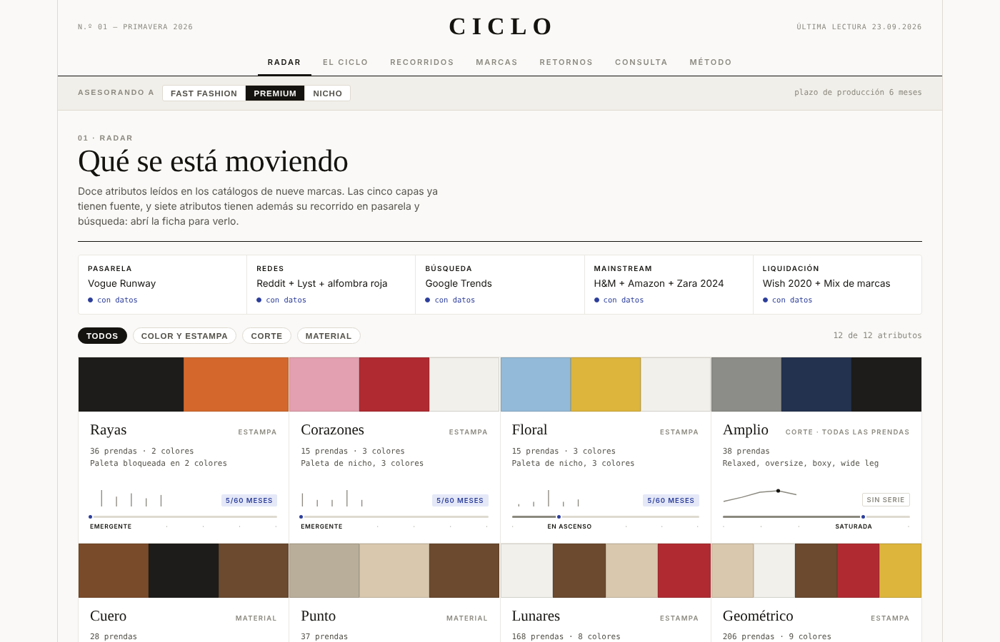
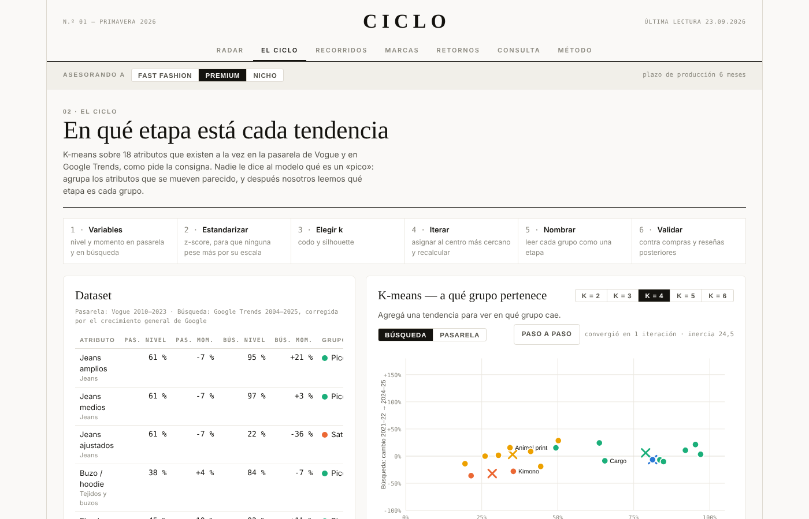
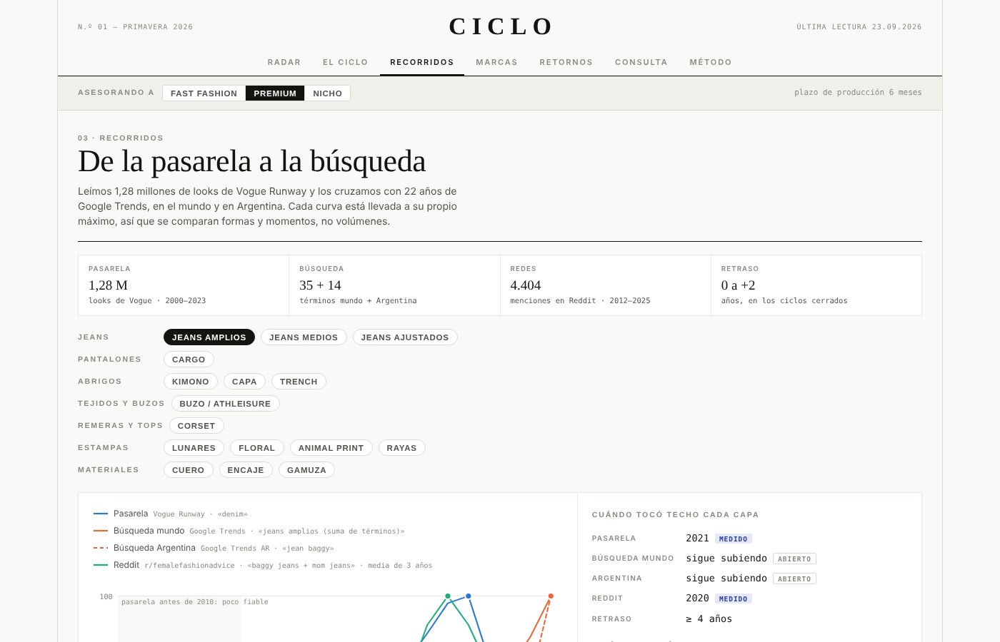
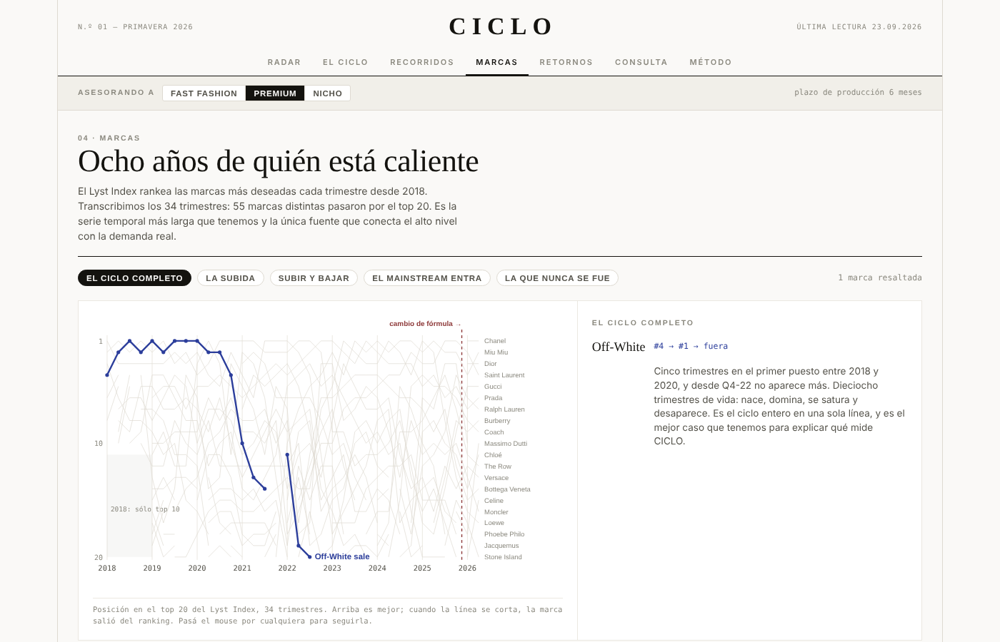
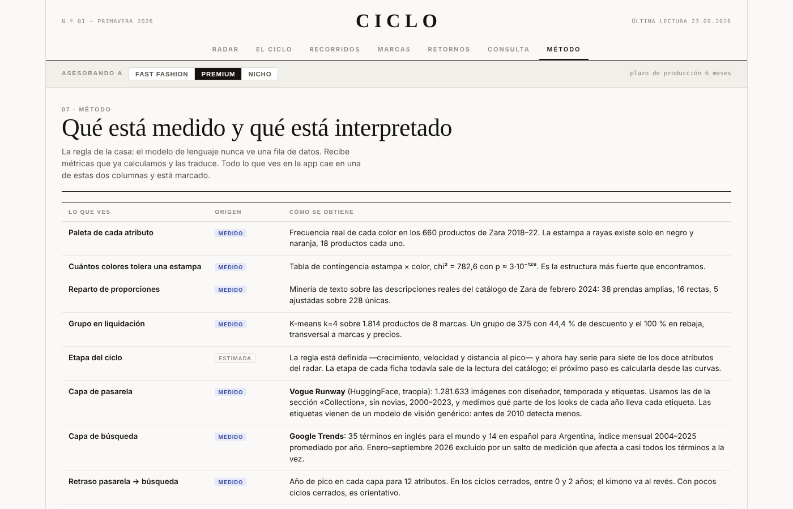

# Entrega 2 · Prototipo de baja fidelidad

**Fecha:** 06/10/2026

## Qué se presenta

El flujo de la app, evidenciando dónde interviene la IA, y la fundamentación de los descubrimientos
basados en datos.

## Link al sitio en este momento

https://claude.ai/artifact/7ZaJ8dZFvqaykZxTnn38Ec

## Capturas

| | |
|---|---|
|  |  |
|  |  |
|  |  |

## Archivos de Figma

| | |
|---|---|
| Presentación (17 láminas) | https://www.figma.com/slides/UMPoglIN4nem2Mo2S7exGe |
| Prototipo navegable, escritorio y mobile | https://www.figma.com/design/zpHKE7YQLBRXJPcbyrb37I |

Las láminas en SVG están en `diseno/prototipos/prototipo_entrega_2_laminas/`.

## Estado del proyecto

**Hecho.** Nueve fuentes conectadas. K-means sobre 18 atributos con validación contra dos capas que el
modelo no vio. Prototipo navegable de 10 pantallas en escritorio y mobile, con 82 y 63 conexiones.
Seis puntos de IA identificados y documentados.

**Falta.** Conectar la Groq API en vivo (IA-5 corre con prompt fijo), separar pasarela y venta por
género, y sumar calzado.
