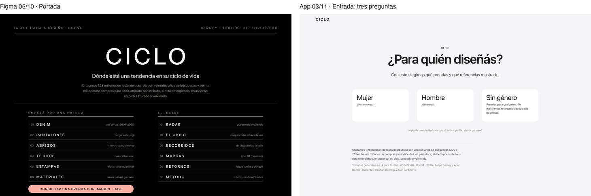
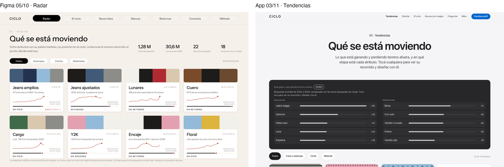
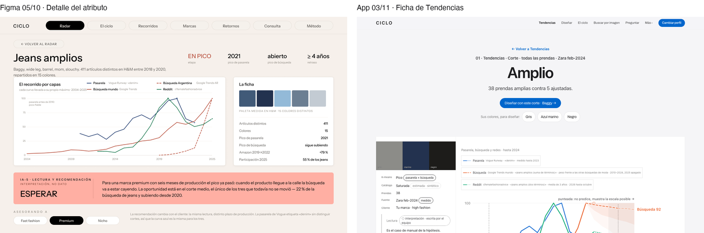
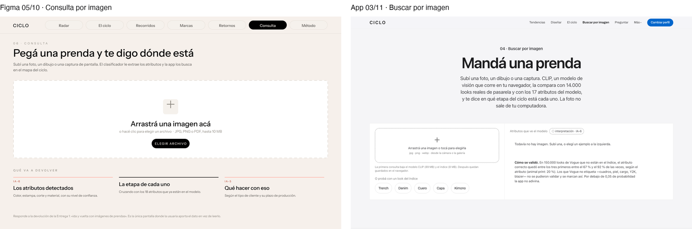
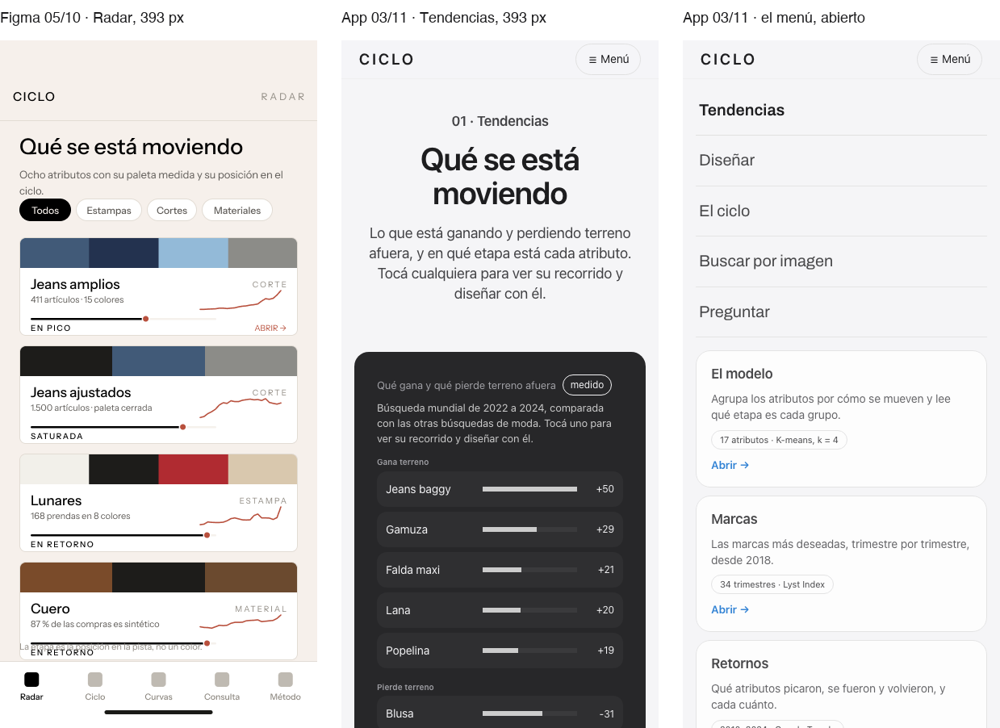

# De Figma al código

**Entrega 3 · criterio 4 · 03/11/2026**

Va lo primero, para que no haya malentendidos: **la app no se construyó leyendo el Figma.** Se escribió
directamente en código (un solo archivo, `app/index.html`) con Claude Code: 99 de los 101 commits que había al 03/11
lo dicen en su firma. El prototipo de Figma de la Entrega 2 y la app de esa misma fecha se hicieron en paralelo y ya
eran distintos el 05/10. Después la app siguió cambiando con cada devolución y el Figma quedó congelado. Este
documento cuenta qué había en Figma, qué se leyó de ahí con un agente de IA (poco, y está detallado), qué se
decidió en el código sin pasar por Figma y en qué se diferencia una cosa de la otra, con la causa de cada diferencia.

---

## 1. Qué había en Figma

| Archivo | Fecha | Qué tiene |
|---|---|---|
| Prototipo navegable, https://www.figma.com/design/zpHKE7YQLBRXJPcbyrb37I | 05/10 (Entrega 2) | Dos páginas: escritorio (10 pantallas de 1440×900, 82 conexiones) y celular (las mismas 10 a 393×852, 63 conexiones) |
| Presentación Entrega 2, https://www.figma.com/slides/UMPoglIN4nem2Mo2S7exGe | 05/10 | 17 láminas |
| Presentación Entrega 1, https://www.figma.com/slides/naASEKNbarWxFM4GKZFUuY | 25/08 | La hipótesis |

Las diez pantallas del prototipo: Portada, Radar, Detalle del atributo, El ciclo (K-means), Recorridos, Marcas,
Retornos, Consulta por imagen, Consulta · resultado y Método. En el celular, las secciones pasan a cinco pestañas
abajo (Radar, Ciclo, Curvas, Consulta, Método) y la consulta ofrece Cámara y Galería en vez de arrastrar un archivo.

El 26/10 se armaron además 22 láminas en Figma Slides y una réplica navegable de la app nueva. El 27/10 salieron
del repositorio sin publicarse: la referencia de la cátedra era una página web y la réplica ya no coincidía con la
app ni un día después (`decisiones.md`, 27/10, «Una sola presentación: la web»). No se usan en esta entrega.

**Figma y código ya eran distintos el 05/10.** El Figma está en sans serif, con menú de pastillas, tarjetas blancas
sobre crema y una caja salmón para la IA. La app de ese día (`entregas/entrega_2/capturas/`) era una revista: Bodoni
Moda en los títulos, mono en mayúsculas espaciadas, menú de texto subrayado. Comparten las diez vistas con los mismos
nombres, el titular «Qué se está moviendo», el selector Fast fashion / Premium / Nicho y la etapa dibujada como un
punto sobre una pista. El registro no dice cuál de las dos se armó primero.

## 2. Qué se leyó del diseño con un agente de IA, y qué no

| | ¿Con un agente? | Cómo fue |
|---|---|---|
| Construir la app (HTML, CSS, gráficos en SVG, K-means, CLIP, Groq) | Sí, pero **sin leer el Figma** | Claude Code, escribiendo en el repositorio a partir de lo que pedía Felipe en la conversación. No se usó `get_design_context`, Code Connect ni variables de Figma; no hay registro de eso en `decisiones.md`. |
| Tokens de diseño (colores, tipografías, radios) | No vienen de Figma | Viven como variables CSS en `:root` y se escribieron en código. La paleta de la capa vigente (#f5f5f7, tarjetas blancas de 18 px, azul #0066cc) se tomó del sistema de las páginas de producto de Apple, no del Figma. |
| Leer el Figma para este documento | Sí, el 03/11 | El MCP de Figma: `get_metadata` para listar las 20 pantallas y `get_screenshot` para las capturas de la izquierda de cada par. Es lectura para documentar, no para construir. |
| La presentación de la Entrega 3 | No | Es una página web escrita en código (`app/presentacion/`), con el mismo sistema visual que la app. |

Lo que sí viajó del Figma a la app, sin agente y como idea: la etapa como posición en una pista y no como color,
las fichas con la paleta medida de la prenda arriba, los filtros en pastillas y el selector de cliente.

## 3. Lo que se decidió en el código, fuera de Figma

El Figma muestra cada pantalla en un solo estado: con datos, sin errores, ya cargada. Todo lo que sigue se decidió
al escribir el código, que es donde aparecieron los casos.

### Estados de lo que se toca

| Estado | Cómo se ve | Por qué |
|---|---|---|
| Reposo | Tarjeta blanca sobre gris perla, sin sombra | La interfaz se corre para que hablen las prendas |
| Hover | Cambia el borde o el fondo; la tarjeta no se levanta ni proyecta sombra | La capa Apple (27/10) sacó la sombra y el levantado que había puesto la capa de uso ese mismo día |
| Foco de teclado | Contorno de 2 px (`:focus-visible`), en tinta en los campos | Se ve sólo con teclado, no al hacer clic |
| Elegido | Borde azul y `aria-pressed="true"` en chips, filtros y opciones de Diseñar | El azul (#0066cc) significa una sola cosa: «se puede tocar / está elegido» |
| Movimiento reducido | Sin transiciones (`prefers-reduced-motion`) | Accesibilidad |

### El celular, a 393 px

El Figma resolvía el celular con cinco pestañas abajo. En el código no alcanzaban: la app tiene once vistas y cinco
principales más «Más» y «Cambiar perfil». Se probó un carril que se deslizaba (escondía Preguntar sin avisar) y
después dos renglones; quedó un botón «Menú» que abre la lista entera, con las vistas secundarias como tarjetas
(par 5). Además, decidido en código el 26/10 tras recorrer las once vistas a 393 px:

- Los gráficos conservan un ancho mínimo para que ningún rótulo baje de ~9 px y se deslizan de costado con un aviso
  «Deslizá el gráfico →». Antes se achicaban hasta rótulos de 3 a 7 px.
- El ciclo medía 22.000 px antes del gráfico; ahora muestra doce tarjetas y «Ver los 65 atributos» (10.200 px).
- Los pasos de Diseñar van en una fila que se desliza, con el paso actual centrado.
- Verificado con Playwright: el ancho de la página es igual al del teléfono, sin scroll horizontal.

### Carga

- **Arranque.** Todas las vistas empiezan ocultas y sólo el código de arranque decide cuál mostrar. Si ese código
  falla, aparecen las tres preguntas con un aviso, nunca una pantalla equivocada sin explicación.
- **CLIP.** Buscar por imagen usa dos descargas: el modelo CLIP (89 MB) y el índice de 14.000 looks (8 MB). Se bajan
  recién en la primera consulta, no al abrir la app, y se muestra el avance: «Bajando el modelo CLIP: 34 de 89 MB
  (sólo la primera vez; después queda guardado)…». La pantalla lo avisa antes de tocar nada: «La primera consulta
  baja el modelo CLIP (89 MB) y el índice (8 MB)». Mientras, se puede probar con un look del índice, que necesita
  sólo los 8 MB.
- **El chat.** Mientras Groq contesta, la pregunta queda bloqueada para no mandar dos veces.

### Errores y faltantes

| Caso | Qué hace la app |
|---|---|
| Sin clave de Groq en «Preguntar» | No llama a nada: abre «Activar el chat» con los tres pasos y dice «Primero activá el chat: son tres pasos, en "Activar el chat". Lo hacés una sola vez.» |
| Sin clave en «Pedir lectura en vivo» (IA-5) | Muestra cómo activarlo; la lectura escrita por el equipo sigue visible |
| Clave mal pegada (401) | «Groq rechazó la API key. Revisá que esté completa y sin espacios.» |
| Límite del plan gratis (429) | «Llegaste al límite del plan gratis de Groq (8.000 tokens por minuto). Esperá un minuto…» |
| Pedido muy grande (413) | Pide una pregunta más corta |
| Sin conexión | «No hubo conexión con api.groq.com. Revisá internet o si un bloqueador impide ese dominio.» |
| Archivo que no es imagen | «Ese archivo no es una imagen.» |
| CLIP no reconoce nada | Si ningún atributo pasa 0,35 de probabilidad: «No determinado», y los tres más cercanos «para orientar, no como respuesta» |
| Atributo sin serie propia | Toma la de un pariente y lo dice («↪ prestado», con el motivo); si no hay pariente, queda neutro con «○ Sin dato directo», nunca en rojo |
| Recomendación sin evidencia | Si no puede escribir de dónde sale cada número, dice «Sin recomendación» |
| El modelo se aparta de la regla | La página calcula la regla por etapa y perfil y avisa si la respuesta del LLM la contradice |

### El modo oscuro

Ni el Figma ni la consigna lo pedían. La app lo tuvo desde el principio, siguiendo la preferencia del sistema. La
auditoría del 26/10 encontró que en oscuro volvían colores que la regla ya había sacado (lavanda en links, rosa en
bordes, verde) y se corrigió. El 27/10, con el sistema visual nuevo, **se apagó**: `<html data-theme="light">`. El
lienzo gris perla y las tarjetas blancas son la identidad de esa capa, y mantener dos temas duplicaba cada revisión.
El CSS del oscuro sigue en el archivo, desactivado.

### Otras dos que no estaban en Figma

- **Links compartibles.** Cada vista, ficha, perfil y diseño a medio armar tiene su dirección (`#disenar?…`).
- **La procedencia, en texto.** Cada número dice si es `● medido`, `◇ interpretado` (borde punteado) o `↪ prestado`.

## 4. Las diferencias, una por una

### 4.1 La entrada por perfil, en lugar de la portada

**Figma.** Una portada negra con dos listas: «Empezá por una prenda» e «El índice».
**App.** Tres preguntas antes de entrar: para quién diseñás, si trabajás para una marca o por tu cuenta, y la
categoría.
**Qué la provocó.** La devolución del 13/10: la interfaz era «un mar de datos y gráficos», y antes del tipo de cliente
había que separar el vínculo laboral, porque cambia el riesgo (donde a una marca le conviene «Esperar», a quien
trabaja por su cuenta le conviene «Explorar»). El 26/10 la portada salió del todo: era un menú escrito a mano en
septiembre, sin calzado ni accesorios y sin salida.

### 4.2 Tendencias como pantalla principal, y todo hasta 2024

**Figma.** El Radar: ocho fichas, cuatro cifras grandes arriba y la búsqueda «2004–2025».
**App.** Tendencias abre con un bloque «Qué gana y qué pierde terreno afuera», búsqueda mundial 2022 a 2024 marcada
como `medido`, y debajo las doce fichas.
**Qué la provocó.** Tres cosas. Las cifras grandes salieron el 13/10 porque no ayudaban a decidir y una contradecía
que la pasarela no adelanta a la búsqueda. El corte en 2024 entró el 20/10: los datos de 2026 de Google Trends vienen
contaminados por un cambio de medición. Y el 26/10 el grupo decidió que lo principal de CICLO es ver qué se mueve:
Diseñar dejó de ser la puerta y pasó a ser una función.

### 4.3 El semáforo, y la IA sin color propio

**Figma.** La recomendación («ESPERAR») en una caja salmón, el color de la IA.
**App.** La acción va en semáforo, siempre con su palabra y un ícono: ▲ Entrar en verde, ■ Esperar o Explorar en
ámbar, ▼ Salir en rojo. Lo interpretado se marca con texto y borde punteado, no con color.
**Qué la provocó.** Al pasar a código, «Entrar» salía en rojo: el salmón y su terracota competían con la acción y
decían lo contrario de lo que significaban (20/10). Se retiró la regla del salmón y el color pasó a significar una
sola cosa, la señal; la procedencia pasó a texto. El 26/10 se separó «describir» de «decidir»: que algo gane o pierda
terreno es un dato y va en tinta; sólo la acción lleva color.

### 4.4 El salto de Tendencias a Diseñar

En el mismo par: el botón azul **«Diseñar con este corte · Baggy →»** no existe en Figma, porque Diseñar no existía.
**Qué la provocó.** Diseñar nació el 13/10 de la devolución («que la app acompañe a quien diseña en vez de mostrarle
todo»). El 27/10, Tendencias pasó de ser para mirar a ser la puerta: cada cosa abre su ficha y la ficha entra a
Diseñar con ese atributo fijo, preguntando sólo lo que falta.

### 4.5 Los nombres de taller

**Figma.** «Jeans amplios», «Tejidos», «Denim», «Materiales».
**App.** Baggy, wide leg, barrel; «Frisa · french terry · Punto afelpado por dentro, la tela del buzo»; Corderoy,
Morley, Crepé. Se ve en `capturas/captura_02_disenar_prenda.png`.
**Qué la provocó.** La regla del 20/10: si un diseñador no puede decir el nombre en voz alta en un taller y que le
entiendan, no va en la interfaz. Cada material lleva el nombre rioplatense, el término de industria y qué es.

### 4.6 La consulta por imagen, real

**Figma.** Una zona para arrastrar «JPG, PNG o PDF, hasta 10 MB» y la promesa de qué devolvería.
**App.** CLIP corre en el navegador y compara la foto con 14.000 looks de Vogue; la foto no sale de la computadora.
Abajo dice cómo se validó (el atributo correcto entre los tres primeros del 67 % al 92 % de las veces, animal print
20 %) y qué no se pudo validar. Hay looks del índice para probar sin subir nada. No acepta PDF.
**Qué la provocó.** En el Figma era una pantalla de intención: el 13/10 la consulta pasó a ser real. Una vez real,
hubo que decir cuánto acierta y qué hacer cuando no reconoce nada (umbral 0,35), cosas que una pantalla estática no
pregunta.

### 4.7 El celular

**Figma.** Cinco pestañas abajo.
**App.** Encabezado con «Menú», que abre todas las vistas; las secundarias como tarjetas con un dato y su fuente.
**Qué la provocó.** Ver 3: con once vistas, cinco pestañas escondían la mitad.

### 4.8 El aspecto general

Fue en tres tiempos: el Figma en sans serif y crema (05/10), la app en revista con Bodoni (05/10 a 27/10) y la app en
el sistema de Apple (27/10). La última quedó, sin buscarlo, más cerca del Figma que de la revista: sans serif,
pastillas y tarjetas blancas. **Qué la provocó:** el profesor seguía viendo la interfaz «muy IA»; tres variantes de
revista no convencieron y Felipe eligió el sistema de las páginas de producto de Apple, «como si Apple vendiese ropa».
Se tomó el sistema, no la marca: ni logo, ni nombre, ni su fotografía (las fotos de pasarela no tienen licencia, así
que las prendas siguen dibujadas).

## 5. Lo que no se hizo, dicho

- El Figma no se actualizó después del 05/10. El prototipo navegable de esta entrega es la app publicada:
  https://felipeberney-boop.github.io/ciclo/
- No hay vínculo entre componentes de Figma y código (Code Connect), ni tokens exportados de Figma.
- No hay un Figma de los estados de error, carga o vacío: se diseñaron directamente en el código (sección 3).

## Archivos

- `figma_a_codigo/par_*.png`: los cinco pares, Figma a la izquierda y app a la derecha.
- `figma_a_codigo/figma_*.png`: las capturas del Figma, bajadas el 03/11 con el MCP de Figma.
- `figma_a_codigo/app_*.png`: la app el 03/11, con Playwright a 1440×900 y 393×852.
- Cada versión anterior de la app está en `diseno/prototipos/versiones_de_la_app/`, con fecha y commit.
