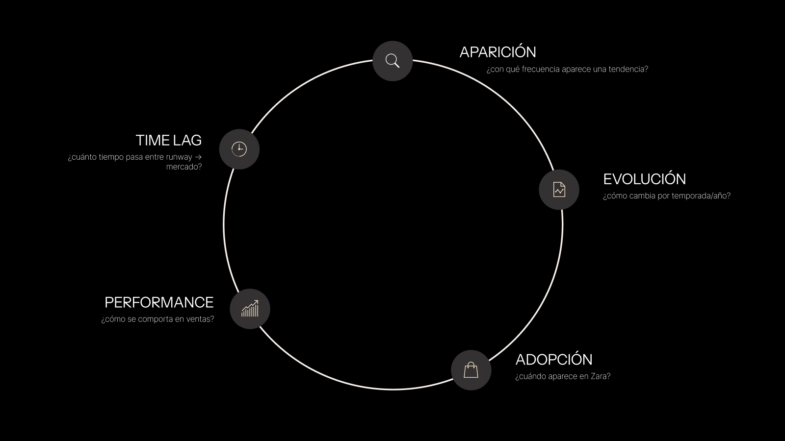
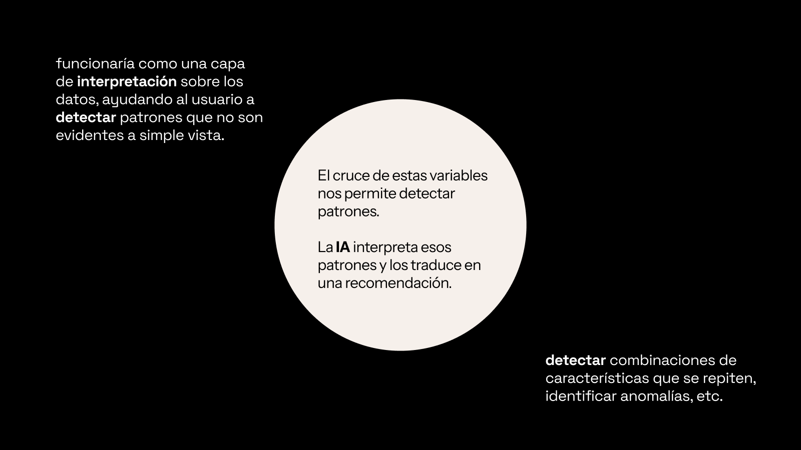
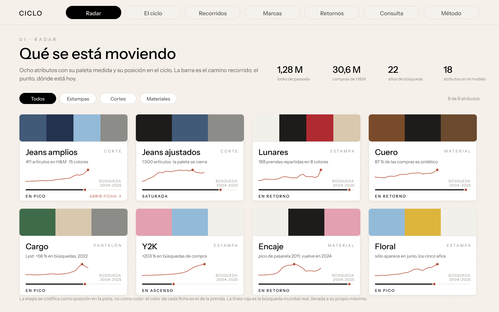
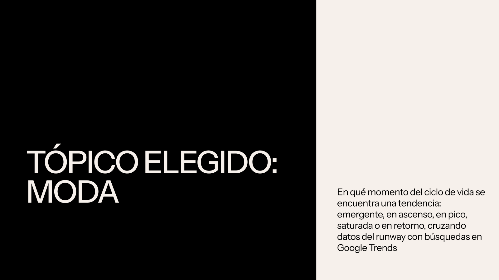

# CICLO · Racional

**Entrega 4 · 17/11/2026** · *Sistemas generativos e IA para Diseño* (K534/K576), UdeSA · Felipe Berney y Abril Dobler ·
Docentes: Cristian Reynaga e Iván Fardjoume

> **Versión del 24/11 (noche).** La primera versión (04/11) la redactó Claude a partir del repositorio y de las conversaciones
> de trabajo con Felipe en Claude Code; se actualizó después de cada cambio grande (el último, las vueltas de rediseño del 24/11
> después de la devolución). Lo que dice quién decidió qué sale de esas conversaciones y cita las palabras de Felipe tal
> como las escribió.

App: https://felipeberney-boop.github.io/ciclo/ · Repositorio: https://github.com/felipeberney-boop/ciclo ·
Figma: https://www.figma.com/design/4lvJEf2ZjBX87sXEySXqa7

Este documento no describe la interfaz: explica por qué es así. Cada sección dice de dónde sale lo que afirma, para que
alguien que no cursó pueda seguir el razonamiento y repetirlo.

---

## 1 · El problema y el contexto

**A quién le sirve.** A quien diseña ropa y tiene que comprometer una decisión antes de saber cómo le va a ir: qué
diseñar, qué mandar a producir o si algo que ya hizo sigue vigente. La decisión cambia según el tipo de marca: una de
fast fashion produce en seis semanas y su prenda tiene que leerse actual un año; una marca de autor produce en tres
meses, pero su apuesta tiene que aguantar cinco.

**Qué decisión necesita tomar.** Entrar, esperar o salir de un atributo: un color, una estampa, un corte o un material.
No «una tendencia», que no se puede contar en ningún dataset (`decisiones.md`, 01/09), ni una prenda entera.

**Cómo se decide hoy, con ejemplos reales.** La industria ya decide con informes, tableros y foros, casi todos pagos y
con métodos que no se ven desde afuera:

| Qué usan | Quién lo produce | Qué dice que da | Fuente |
|---|---|---|---|
| **Informes y briefs de tendencia** para comprar | WGSN · *Fashion Buying* (lanzado el 08/08/2024) | «Product direction, the key trends to back next, and how deeply to invest in specific styles»; briefings de materiales, estampas y color, y una proyección de color a dos años | [Comunicado de WGSN](https://wgsn.com/en/wgsn/press/press-releases/wgsn-launches-fashion-buying-dedicated-intelligence-and-forecast-led). La precisión que promete es del vendedor, sin validación pública |
| **Tablero que lee redes con visión por computadora** | Heuritech | Unos tres millones de imágenes de redes por día. Dior lo usó para una nueva versión del bolso Miss Dior, y Rabanne para ver cómo respondía el público a su bolso de 1969 | [Wallpaper, 30/12/2023](https://www.wallpaper.com/fashion-beauty/is-ai-the-future-of-fashion-trend-forecasting) |
| **Tablero de predicción sobre pasarela** | Tagwalk (lanzado en diciembre de 2024) | Colores, materiales y temas hasta un año antes, sobre etiquetas de más de 400.000 imágenes de 1.000 marcas | [Tagwalk](https://www2.tag-walk.com/fr/news/tagwalk-s-trends-prediction-dashboard-part-of-the-time-s-best-inventions-of-2025) |
| **Foros de materiales y color** | Première Vision | Las direcciones de color y tela se arman 18 a 24 meses antes de que la colección llegue a la tienda | [Première Vision](https://www.premierevision.com/articles/78f85898-1079-f111-b337-000d3a3a1397/how-are-premiere-vision-trends-created-) |
| **Tableros de surtido y precio** | EDITED | Surtido, precios, fechas de lanzamiento y tendencias de la competencia | [Harvard D3](https://d3.harvard.edu/platform-rctom/submission/data-driven-dress-dealing/index.html) y los casos de clientes de EDITED (material del vendedor) |
| **El circuito tienda → diseño** | Zara | Los encargados de tienda pasan a diario lo que piden los clientes; el diseño responde en semanas | Ferdows, Lewis y Machuca, «Rapid-Fire Fulfillment», *Harvard Business Review* 82(11), noviembre de 2004 (leído en resúmenes; conviene citar el original) |

**Por qué importa equivocarse.** BoF y McKinsey ponen el inventario en lo más alto de la agenda de la industria para
2025: sobrestock y quiebres de stock a la vez ([resumen del CFDA de *The State of Fashion 2025*](https://cfda.com/resources/sustainability-resource-hub/library-lexicon-annex/the-state-of-fashion-report-2025-mckinsey-company-and-bof-insights/)).
Una lectura de tendencias que se equivoca no queda en un informe: se convierte en prendas que nadie compra.

**El hueco que ocupa CICLO.** Esas herramientas son pagas (un informe de temporada de Tagwalk cuesta entre 2.500 y
6.000 euros según el tamaño de la empresa, según [su página de informes](https://www.tag-walk.com/en/spring-summer-2024-catwalk-report)) y muestran el resultado, no el cálculo. CICLO
trabaja con datos públicos, dice de dónde sale cada número y dice lo que no puede hacer: no predice.

**Lo que no hicimos, y por qué.** No hay entrevistas con diseñadores. El 27/10 se armó un jurado ciego (cinco a diez
personas de diseño ubicando los 17 atributos en su etapa) y se descartó el mismo día: dependía de conseguir gente que no
controlábamos («no me gusta esto de las entrevistas es un quilombo», Felipe). La validación se hizo con una fuente que el
modelo no ve, Reddit (punto 2). El costo es que este punto se apoya en cómo trabaja el mercado, con ejemplos públicos, y
no en conversaciones con quien usaría la app.

---

## 2 · La hipótesis, en una frase

> **Cruzando lo que propone la pasarela con lo que busca la gente, se puede ubicar cada atributo de moda en su etapa del
> ciclo y distinguir lo que está subiendo de lo que no; esa lectura coincide con fuentes que el modelo nunca vio.**

**Qué asumimos.** Que la etapa de un atributo se ve en dos capas a la vez: cuánto aparece en los desfiles y cuánto lo
busca la gente. Que «gana terreno» se mide contra las otras búsquedas de moda, no en valores absolutos, porque Google
crece y cambia cómo mide. Que el tipo de marca cambia qué conviene hacer con una misma etapa.

**Qué no podemos afirmar.** Que CICLO prediga: cuatro métodos de predicción no le ganan a repetir el último valor
(`hipotesis.md`). Que la pasarela adelante a la búsqueda: no lo hace ni por año ni por temporada; la prueba por
temporada se registró antes de tener los datos y se rechazó (27/10). Que la búsqueda prediga la venta: contra 5.577
productos con venta real (VISUELLE), explica el 0,1 %. Y «en retorno»: con la pasarela corregida (18/11) ningún
atributo cae ahí, así que esa etapa hoy no tiene con qué probarse.

**Lo que sí está probado.** Lo que el K-means pone en ascenso es lo que más crece en Reddit, una fuente que no usa: los
dos atributos en ascenso (Y2K, jeans amplios) están entre los tres que más crecen; el tercero, cargo, queda en pico, y el
crecimiento medio baja de etapa en etapa (+194 %, +64 %, −29 %; η² = 0,71, p = 0,013, con la pasarela hasta 2025). La prueba se
fijó antes de calcular (27/10) y con las etapas de entonces también se sostuvo (p = 0,0013). El detalle, prueba por
prueba, está en `hipotesis.md`.

**Una corrección de los datos (18/11).** Desde 2022 Vogue dejó de etiquetar los looks: en 2022 tiene etiquetas el 76 %,
en 2023 el 48 % y Fall 2023 ninguno. La serie de pasarela dividía por todos los looks, así que en 2022–2023 todas las
curvas caían juntas por falta de etiquetas. Esos dos años ahora los lee un clasificador CLIP por atributo, entrenado
con las etiquetas de 2010–2021 (correlación con ellas, de 0,84 a 0,99), sobre todos los looks. Cambiaron 15 de las 17
etapas: lo que estaba «saturado» quedó mayormente «en pico», jeans amplios y cargo pasaron a «en ascenso» y ningún
atributo quedó «en retorno». Ese mismo día la pasarela llegó a 2025 y entró al modelo: cambiaron 6 etapas más (jeans
medios y ajustados, kimono, capa y piel a «saturada»; cargo a «en pico»).

**De dónde salió.** La hipótesis de la Entrega 1 prometía anticipar: «señales tempranas de los desfiles». Las pruebas
la corrigieron dos veces. La unidad pasó de «tendencia» a atributo, y el foco, de anticipar a leer el presente.

---

## 3 · Los datos y su trazabilidad

**Qué datos, para qué y cómo conviven.** En la app lo cuenta una sola pieza, arriba de todo en Acerca de: «Cómo se
arma una señal» (en el ítem 8). Lleva a los jeans de los datos a la señal en siete pasos.

```
ENTRAN AL MODELO                    SE CRUZAN POR                  QUÉ SALE
Pasarela · Vogue Runway  ──┐                                    ┌─ La etapa (un lugar en la pista)
Búsqueda · Google Trends ──┴──►  atributo × año  ──► K-means ──┼─ La señal (etapa + tu perfil, por una regla)
                                 (17 atributos,                 └─ El cono (hasta la ventana, con su error)
COMPRUEBAN DESPUÉS, NO ENTRAN     4 rasgos, k = 4)
Reddit · Google Shopping · Amazon · Lyst
```

**Las fuentes** (completas, con fechas de descarga y licencias, en `datasets/fuentes_y_descargas.md`):

| Fuente | Quién la produce | Cada cuánto se actualiza | Cubre | Licencia | Limitación |
|---|---|---|---|---|---|
| Vogue Runway (`traopia/vogue-runway`) | Condé Nast; el dataset lo armó un tercero en HuggingFace | No se actualiza: se scrapeó el 31/03/2023 | 1.281.633 imágenes con su vector CLIP; usamos 902.566 looks de colección, 2000–2023 | Sin licencia declarada; uso académico, sin redistribuir | Las etiquetas las puso un modelo de visión genérico, y desde 2022 Vogue dejó de etiquetar (2022: 76 %; 2023: 48 %; Fall 2023: ninguno). 2022–2023 se leen con CLIP (abajo) |
| Vogue Runway 2024–2025 (`tonyassi/vogue933k-embedding`) | Condé Nast; el dataset lo armó otro tercero en HuggingFace | No se actualiza | 933.328 looks, 1990–2025; usamos una muestra de 20.000 por año de 2024 y 2025 (y 10.000 de 2022 y 2023 para empalmar), bajada a 400 px sólo para calcular su vector CLIP (18/11) | Sin licencia declarada; las fotos no se guardan ni se suben | Es una muestra: un año entra sólo si su intervalo de 90 % abarca 25 puntos o menos. Pasan 13 de 15 atributos; lunares y piel quedan hasta 2023. 2026 no está en ningún dataset |
| Google Trends | Google | Continua; exportado el 22/09 y el 20–21/10 | 65 series, mundo y 14 términos de Argentina, 2004–2024 | Términos de servicio de Google | Índice relativo, no volumen; salto de medición desde 2025, por eso se corta en 2024 |
| Reddit (Arctic Shift) | Usuarios de r/femalefashionadvice y, desde el 17/11, de r/malefashionadvice (dos series separadas) | Continua; consultado el 22/09 y el 13/10, y bajados los dos foros enteros el 17/11 | Títulos de 2012–2025: 177.668 posts en mujeres y 581.184 en hombres; entran los términos con 100 posts o más (25 en mujeres, 28 en hombres) | Datos públicos, con atribución | Dos foros de consejos en inglés, mayoría de Estados Unidos; la validación (p = 0,0013 la preregistrada; 0,013 con el modelo de hoy) se hizo sólo con el de mujeres. La serie de hombres se ve, pero no entra al modelo ni a la validación |
| H&M, Amazon, Google Shopping | H&M (Kaggle), Amazon (McAuley Lab), Google | Fijos | 30,6 M de compras 2018–2020; 1,1 M de reseñas 2012–2023 | Kaggle académico; Amazon sin licencia declarada | Validan después; no entran al modelo |
| Lyst Index | Lyst | Trimestral | 34 trimestres, Q1-18 a Q2-26, 55 marcas | Editorial, citado | Cambió la fórmula en Q1-26: se calcula dentro de cada tramo |
| Zara 2018–22 y Mix de marcas | Kaggle | Fijos | 660 y 2.176 productos | Kaggle | **Sintéticos**: sólo muestran el método |

**Fuentes evaluadas y descartadas.** Se probaron y no entraron. No aparecen en la app (desde el 17/11, Acerca de
muestra sólo lo que se usa); quedan acá, con el motivo, porque un resultado negativo bien documentado también es
método.

| Fuente | Qué se probó | Por qué no entró |
|---|---|---|
| Instagram | Volumen de hashtags por atributo | No existe serie histórica de hashtags a ningún precio. Instagram sacó el feed cronológico en 2022 y limitó a 5 hashtags por post en diciembre de 2025: es una señal que se degrada sola |
| TikTok (Research API) | Acceso académico a la serie de videos | La API de investigación no acepta instituciones argentinas |
| Pinterest Trends | La serie de búsquedas de Pinterest | Sólo para clientes Enterprise; no hay forma pública de bajarla |
| Zara 2018–22 y Mix de marcas 2025 (Kaggle) | K-means y árboles de decisión (08/09) | Son sintéticos: correlación máxima 0,099 y 0,018; el árbol acertaba 50,8 % contra 50,2 % de base. Quedan como demostración de método |
| VISUELLE (5.577 productos con venta real) | Si la búsqueda predice la venta | La explica en un 0,1 %. Se usó para la prueba y no entra |
| Wish (agosto de 2020) | La copia ultra barata | Una sola temporada, y el «precio de lista» no sirve (el 47 % no tiene descuento y el 25 % dice más de 72 %). No responde ninguna pregunta de la app |
| Un jurado de diseñadores | Cinco a diez personas ubicando los 17 atributos, a ciegas (27/10) | Dependía de gente que no controlábamos; la validación se hizo con Reddit, que el modelo no ve |

**La clave.** Todo se cruza por **atributo × año**. Cada atributo tiene un nombre de taller («jeans amplios») y, por
cada fuente, el término con el que se lo busca (la etiqueta de Vogue, el término de Google, la palabra en Reddit). Están
en `REC` (`app/index.html`), uno por atributo.

**Las variables que calcula CICLO.** El diccionario de las columnas crudas está en `datasets/diccionario.md`. Estas son
las que salen del cálculo:

| Variable | Qué es | Unidad y rango | Cómo se calcula |
|---|---|---|---|
| Pasarela de un año | Cuánto aparece el atributo en los desfiles de ese año | Índice 0 a 100 (100 = su máximo) | Hasta 2021, proporción de looks con la etiqueta de Vogue. De 2022 a 2025, la probabilidad media que da un clasificador CLIP por atributo (regresión logística sobre el vector de cada look, entrenada con las etiquetas de 2010–2021; correlación con ellas de 0,84 a 0,99), llevada a la escala de las etiquetas con 2016–2021. En los gráficos ese tramo va punteado |
| Nivel de pasarela (`pn`) | Dónde está hoy contra su propio máximo | 0 a 1 (1 = en su pico) | Media 2024–25 sobre el máximo 2010–2025. Lunares y piel, que no pasaron el control de 2024–2025: media 2022–23 |
| Momento de pasarela (`pm`) | Cuánto cambió | Proporción, puede ser negativa | Media 2023–25 contra media 2020–22. Lunares y piel: 2021–23 contra 2018–20 |
| Nivel de búsqueda (`bn`) | Igual, en la búsqueda mundial | 0 a 1 | 2023–24 sobre el máximo hasta 2024, con la búsqueda corregida por el crecimiento general de Google |
| Momento de búsqueda (`bm`) | Igual | Proporción | 2023–24 contra 2020–21 |
| Gana o pierde terreno | Cuánto peso ganó dentro de las búsquedas de moda | Puntos, de −31 a +50 en los datos de hoy | Peso del término frente a las otras búsquedas de moda, 2022→2024 |
| Etapa | En qué punto del ciclo está | Una de cinco | K-means (abajo) |
| Ventana | Cuánto tiene que seguir actual la prenda | 1, 2, 3 o 5 años, según la categoría | Supuesto de diseño (`decisiones.md`, 13/10) |
| Error a la ventana | Cuánto se movió de verdad la búsqueda a esa distancia | ±14, ±17, ±21 o ±26 puntos | Error absoluto medio del cono, medido en 224 tramos (`codigo/calcular_cono.py`) |
| Señal | Qué conviene hacer | Entrar, Esperar o Explorar, Salir, Sin dato | Regla fija (abajo) |

**Cómo se construye cada índice.**
- **El K-means.** 17 atributos que existen a la vez en Vogue y en Google Trends (sin calzado). Cuatro rasgos: nivel y
  momento de pasarela y de búsqueda, estandarizados (z-score) para que ninguno pese más por su escala. k = 4, que
  arranca de centroides guardados para que el resultado sea siempre el mismo: desde el 18/11, el mejor de 50
  arranques con semilla 42 (inercia 23,1; arrancar de los centroides anteriores dejaba 27,7). Los grupos se nombran por
  el prototipo de etapa más cercano; si el que le toca queda a más de 1,5 veces la distancia del más cercano, comparte
  esa etapa (18/11: sin esa regla, jeans amplios y cargo salían «emergentes», que quiere decir lo contrario de lo que
  muestran sus datos). Una tendencia nueva se asigna al centroide más cercano y nunca reentrena el modelo: hacerlo
  convertía a cada tendencia nueva en su propio grupo y les cambiaba el nombre a los demás (22/09). La silhouette no
  elige k = 4: da 0,28, 0,30, 0,30 y 0,31 para k de 2 a 5. Nos quedamos con 4 porque con menos grupos las etapas no se
  separan, y la pantalla del modelo lo dice (20/10).
- **La señal.** Si el atributo tiene etapa del K-means, decide la regla de CICLO para la categoría (`CONSEJO`): con un
  atributo en pico, fast fashion entra y una marca de autor sale. Si no tiene etapa pero tiene serie, decide si gana o
  pierde terreno (más de 3 puntos). Si no tiene nada, queda sin dato: es neutro, porque «no tengo datos» no es lo
  mismo que «está cayendo». Si diseñás por tu cuenta, donde la regla dice Esperar dice Explorar.
- **El cono.** Desde el último dato bueno, cada curva sigue la mediana de lo que pasó en la historia a esa distancia,
  con una banda donde cayó el 60 % y el 90 % de los casos. No es un pronóstico: en las pruebas empata con repetir el
  último valor en la pasarela (20,9 contra 20,9) y apenas mejora en la búsqueda (11,4 contra 12,6), y por eso la
  pantalla lo dice (13/10).

**Cómo se interpretan los colores.** El color dice una sola cosa: si conviene avanzar o frenar. Verde es Entrar, ámbar
es Esperar o Explorar, rojo es Salir, siempre con la palabra y un ícono (▲ ■ ▼), y lo que no tiene dato queda en gris.
La etapa no tiene color: es una posición en la pista. De dónde sale un dato tampoco tiene color: ● medido, ◇
interpretado, ↪ prestado de un pariente. El azul significa sólo «se puede tocar». Los grupos del K-means usan tonos que
no se confunden con la señal.

**El repositorio.** Decisiones fechadas en `decisiones.md`, versiones en `historial.md`, fuentes en
`datasets/fuentes_y_descargas.md`, diccionario en `datasets/diccionario.md`, prompts versionados en `prompts/`. Los
datos crudos no están (pesan demasiado o necesitan cuenta); están los links y lo calculado.

---

## 4 · El modelo: qué entra, qué se calcula, qué sale

```
ENTRA                                   SE CALCULA                                  SALE
Pasarela por atributo y año  ─┐         nivel y momento (4 rasgos)                  la etapa
Búsqueda por atributo y año  ─┼──────►  z-score → K-means k=4 → nombre de etapa ──► la señal, con la categoría
Tu perfil (público,           │         regla CONSEJO × categoría × vínculo         el cono, con el error a tu ventana
  vínculo, categoría)        ─┘         mediana histórica a h años
Una foto (opcional)          ────────►  CLIP: parecido con 14.000 looks            atributos que ve y looks parecidos
Una pregunta (opcional)      ────────►  LLM con métricas ya calculadas             una lectura marcada ◇ interpretación
```

**La IA, dónde entra y dónde no.** CLIP (ViT-B/32) lee imágenes: estima la pasarela de 2022 a 2025, cuando Vogue ya
no etiquetaba, y, en el navegador, compara la foto que sube la persona con 14.000 looks; acierta el atributo entre los tres primeros entre el 67 % y el 92 % de las
veces según el atributo, en 150.000 looks que no vio. El modelo de lenguaje (Groq, `gpt-oss-120b`) **nunca ve una fila
de datos**: recibe métricas ya calculadas y las traduce, y lo que dice aparece marcado como interpretación. La etapa y
la señal no las decide la IA: las deciden el K-means y una regla fija.

**Qué quedó afuera y por qué.**
- **La predicción.** Se probó de cuatro maneras y con un modelo global; ninguna le gana a repetir el último valor.
- **2025 y 2026 en la búsqueda.** Google cambió la medición: en 2025, 15 de 16 series suben y 12 tocan su máximo.
- **2026 en la pasarela.** No está en ningún dataset; la pasarela llega a 2025, y lunares y piel, a 2023.
- **El calzado.** Dos de ocho estilos tienen señal en la búsqueda; CLIP lee la ropa, no el zapato. Está contado como
  resultado, no escondido (26/10).
- **Pasarela y venta por género.** Vogue y los agregados de H&M no traen esa columna; está declarado en Acerca de.
  Lo único separado por género es Reddit (un foro de mujeres y otro de hombres, desde el 17/11, a pedido de la
  cátedra): se ve en El ciclo y en la ficha, pero no entra al modelo ni a la validación.
- **Lo emergente.** Ningún atributo del set está empezando, aun con la pasarela hasta 2025.

---

## 5 · El usuario y el flujo

**El perfil.** En la Entrega 1 la cátedra pidió que dejara de ser genérico; pasó a ser una forecaster independiente
que asesora a varias marcas. Desde el 13/10 es quien diseña, porque la app dejó de mostrar todo y pasó a acompañar una
decisión de diseño.

**El recorrido (desde el 24/11).**
1. El home: «Qué diseñar. Y cuándo.», cómo funciona, las dos fuentes y qué señal obtenés, una idea
   por pantalla.
2. «Creá tu proyecto»: nombre, email y las tres preguntas en una sola pantalla.
3. Mis ciclos, la herramienta de tu proyecto: una línea con qué gana y qué pierde terreno (el gráfico, en un
   desplegable), y Mis tendencias, los 65 atributos agrupados por señal, dos filas por grupo, cada uno con su mini barra
   de búsqueda.
4. La ficha de un atributo: primero la señal y su porqué, después «Diseñar con…».
5. Diseñar.
6. Explorar las tendencias del mundo: lo mismo para todos, sin señal, con buscador y el recorrido de cualquier atributo.
7. Preguntale a CICLO.
8. El brief.

Quien entra por «Sólo estoy mirando» ve en Mis ciclos y en Explorar un aviso que dice que está sin proyecto, con el botón
para crearlo. Está paso a paso, con capturas en la compu y en el celular, en el readme
(`codigo/capturar_recorrido.js`). Hasta el 24/11 el recorrido empezaba con las tres preguntas en pasos y caía en
Tendencias; así está en papel, una pantalla por hoja, en `entregas/entrega_4/disenos_en_papel/` (del 04/11).

**Por qué la ramificación es así.** Tres preguntas: ¿para quién diseñás? (mujer, hombre, sin género), ¿trabajás para
una marca o por tu cuenta?, y la categoría. La del vínculo viene de una devolución del 13/10 (`decisiones.md`). En la
Entrega 3 la cátedra preguntó si esas eran las mejores palabras para ramificar, y lo pusimos a prueba.

**La alternativa que probamos y descartamos.** El 04/11 la entrada pasó a preguntar por el objetivo: «¿Qué estás por
decidir?», con Qué diseñar, Qué producir y Si algo ya pasó. Salió de evaluar tres variantes:

| Variante | La pregunta | Por qué no o por qué sí |
|---|---|---|
| El alcance | Una colección · Una prenda · Si algo sigue vigente | Colección o prenda no cambia ningún número: habría que inventar ventanas |
| El compromiso | Qué diseñar · Qué producir · Si algo ya pasó | La que se construyó: en la app, en papel y en el recorrido del readme |
| El plazo | ¿Para cuándo en tienda? · ¿Cuánto tiene que durar? | Da la ventana directo, pero pierde el posicionamiento y obliga a reescribir las reglas |

Al usarla, no funcionó. Obliga a la persona a traducir su situación a una categoría abstracta antes de haber visto nada
de la app, y eso la frena en la primera pantalla: no se entendía qué elegir. El mismo día volvimos al vínculo laboral.

**Por qué el vínculo.** Es una pregunta que un diseñador contesta sin pensar. Y lo que de verdad cambia la lectura se
deduce mejor de las respuestas que ya tiene la entrada que de una pregunta por el objetivo. Cuánto cuesta equivocarse
sale del vínculo: quien trabaja por su cuenta no compromete producción ni stock, así que donde a una marca le conviene
Esperar, a esa persona le conviene Explorar, empezar a diseñar sin comprometer la serie. Cuánto falta hasta que la
prenda se produce, y cuánto tiene que durar, salen de la categoría. Lo que Cristian criticó no era la pregunta sino el
texto de más dentro de cada cuadrado, y ese texto ya se había sacado el 03/11.

**La categoría se queda**, y esto no era obvio: se pensó que el lead time la podía reemplazar. No puede. La categoría
lleva dos cosas que el lead time no tiene: la ventana (de la que depende el error medido, porque los lead times son
todos menores a un año y el error se mide año a año) y el posicionamiento (en pico, fast fashion entra y una marca de
autor sale, aunque la de autor tenga un lead time más corto que high fashion). Las categorías cambian según la rama:
para una marca, high fashion, contemporary, fast fashion y de autor; por tu cuenta, el tipo de prenda que querés
diseñar.

Hasta el 24/11, después de las tres preguntas la app abría en Tendencias, con el perfil escrito arriba y «Cambiar» al
lado. Desde la devolución de la Entrega 4 las tres preguntas son un proyecto con nombre que se guarda en el navegador
(se pueden tener varios y cambiar entre ellos desde el avatar), y la app abre en Mis ciclos con la línea «PROYECTO
<nombre> · Mujer · Para una marca · Fast fashion · Editar». Quien todavía no quiere contestar tiene «Sólo estoy mirando»
(10/11): entra a Explorar ciclos con un perfil general, una marca contemporary sin género, y la pantalla lo dice.

**Qué filtra de verdad el proyecto**, porque la devolución preguntó por qué Rayas mostraba Reddit de hombres en un
proyecto de mujer. El público cambia sólo Reddit (el foro de mujeres o el de hombres); Google Trends y Vogue no separan
por género, y la pantalla lo dice. El tipo de marca y el vínculo cambian la señal (los plazos y Esperar o Explorar), no
los datos. Por eso Mis ciclos muestra la búsqueda de todos con la señal de tu proyecto encima, y Explorar ciclos muestra
los mismos datos sin señal.

---

## 6 · Las decisiones de diseño

**Lo más importante de cada pantalla.**

| Pantalla | Lo primero que se ve | Por qué |
|---|---|---|
| La entrada (hasta el 24/11) | Una banda de fotos de pasarela que corre sola a pantalla completa, con la pregunta encima y sus opciones (17/11). Las fotos responden a lo que se contesta: looks de mujer, de hombre o sin género, y después casas de la escala elegida | Cada respuesta cambia la lectura (lo que cambia está en Acerca de). La ropa primero, como i-D y Vogue Runway; el gráfico que estuvo antes en ese lugar repetía el de Tendencias cuatro pantallas seguidas |
| Tendencias (hasta el 24/11; hoy, Mis ciclos) | Un gráfico que rota entre cinco lecturas animadas de la búsqueda: qué sube y qué baja, qué está en su máximo, cuándo picó cada uno, lo que vuelve y uno contra otro (hasta el 10/11, un bloque oscuro de texto que la devolución marcó como obstructivo); debajo del título, una fila de looks que se mueve, y las tarjetas como fotos a sangre | Es lo que se mueve hoy, medido; después, cada atributo con su etapa y su señal. Sólo lo que tiene dato medido: el catálogo sintético no se muestra. La fila de looks queda sólo acá, donde la sección habla de «qué se está moviendo» |
| El home (24/11) | «Qué diseñar. Y cuándo.», al lado de una foto de pasarela que cambia con cada idea | Lo que hace CICLO en una línea: qué diseñar y cuándo. Después, sólo cómo funciona, de dónde salen los datos, qué te da y el formulario; se sacó la sección «Una etapa para cada atributo», que no se entendía |
| Mis ciclos (24/11) | El proyecto y una línea, «29 ganan terreno, 32 lo pierden», con el gráfico en un desplegable; enseguida tus tarjetas por señal, cada una con su mini barra de búsqueda | Es la herramienta de tu proyecto. De tres layouts (gráficos al costado, apilados o en un desplegable) quedó el desplegable: las tarjetas arrancan arriba, sin gráficos apretados, y el dato de cada atributo vive en su tarjeta. «Cuándo picó cada uno» se descartó: 26 de los 65 atributos tienen su máximo en 2010, el primer año de la serie |
| Explorar (24/11) | «Explorar las tendencias del mundo»: cualquier género, cualquier mercado; seis filas de tarjetas verticales y «El recorrido de [atributo]», con el nombre como selector | Mis ciclos es MI proyecto; Explorar es TODO, y los títulos lo dicen. Las fotos van verticales para que se vea el look entero; los atributos sin foto, al final |
| La ficha | La señal grande, con una línea de por qué | Es la decisión. El gráfico la sostiene; el detalle está en el «?». Con menos de tres capas de datos, una franja por capa en vez del gráfico de capas, para que una sola línea no parezca un dato flojo |
| Diseñar | La pregunta del paso, con la foto de pasarela de cada prenda y su silueta como etiqueta (18/11) | Un paso, una decisión; lo elegido queda en una barra abajo, cada elección con su miniatura. Un tipo sin foto propia conserva su dibujo: prestarle la foto de otro diría algo falso de esa prenda |
| El ciclo (hasta el 24/11; hoy, Explorar) | Los 48 atributos con serie de búsqueda y foto, a la vez, sobre un eje de 2004 a 2024: cada foto en el año de su pico, subiendo y bajando con su búsqueda medida mientras un cursor recorre veinte años en veinte segundos (18/11) | La pantalla trata de cuándo picó cada uno y cuánto tardó en volver. El movimiento es la serie medida, no una animación decorativa; tocar una foto abre ese atributo |
| Preguntale a CICLO, «Preguntar» en el menú (antes Buscar por imagen, Preguntar, Tiza y Lectura) | Vacía, una foto que rota entre casas, las preguntas sugeridas y «Sumá tu diseño». Después, un solo hilo: tu imagen o tu pregunta, y la respuesta con todo adentro (lo que leyó CLIP, la curva que importa, los looks parecidos, la conclusión en una frase) | La devolución pidió filtrar lo que devuelve la IA: primero la conclusión, después el dato que la sostiene y su curva; el detalle queda plegado. Una sola columna, para que se sienta un asistente y no un tablero con un chat al costado. Debajo de la caja, siempre, qué modelo contesta, por qué API y cuántos tokens usó (o que sin clave contestan las reglas, con 0 tokens) |
| El brief | El encargo de una casa real con la foto de su desfile; después, el veredicto por partes, centrado en el eje: el puntaje enorme, la racha, el porqué, las tres casas y una frase para copiar (18/11). Desde el 24/11, una segunda pestaña, «¿Lo viste venir?», y un premio: piezas de archivo | La devolución de la pirueta: «no es un juego, no tiene hook». La racha le da algo que perder, el ritmo del veredicto hace que el puntaje llegue primero y el archivo da algo que juntar |
| Acerca de (hasta el 17/11, «Método») | «Cómo se arma una señal», animado; después los datos y el modelo como diagramas; arriba, la pared del corpus, las fuentes y el modelo rotando cada 9 segundos | La devolución pidió que se entienda qué datos se usan y cómo conviven, sin tener que leer |

**Cada número dice de dónde sale.** Desde el 17/11, cada número medido muestra su fuente al pasar el mouse (o al
tocarlo en el celular): la fuente, el período y las observaciones. Desde el 18/11, a pedido de la cátedra, cada fuente
tiene una ficha con tres partes: de dónde viene, cómo la procesamos y qué sacamos de ella. Nada queda fijo en
pantalla: la información está, pero no ensucia la decisión. Lo interpretado (lo que lee CLIP, lo que escribe el modelo)
no lleva fuente medida: lleva su marca ◇.

**Cómo se jerarquizó.** Tres grupos para cada bloque de texto: lo que se necesita para decidir se queda; lo que aclara
cómo usar la app pasa a un «?» que se abre si lo tocan; lo que no aporta se borra (`decisiones.md`, 04/11).

**Tipografía.** Había 31 tamaños de letra y 49 combinaciones de tamaño y peso (medido, 04/11). Quedan cinco estilos:
Desde el 24/11 hay una escala fija en la **letra del sistema de Apple** (SF Pro en Apple, Inter en el resto): H1 56
(36 en el celular), H2 32, H3 22, H4 18, Párrafo 17, Etiqueta 12 en mayúsculas y Dato 40; títulos en 600, nunca más.
Nada que se lea baja de 16 px. La Bodoni queda sólo en el logo. Cada estilo tiene un uso: H1 nombra la pantalla, H2 cada
bloque, H3 lo que se toca.

*Por qué la letra del sistema.* Del 27/10 al 17/11 todo iba en la letra del sistema, por la referencia que pasó la
cátedra (el sistema de diseño de Apple): la interfaz se corría y la ropa hablaba. Después de la devolución de la
Entrega 4 (el diseño se veía superficial, sin identidad propia) los títulos y los números pasaron a Bodoni Moda, la
Didone de Vogue, fina y en 400. Duró una semana: el 24/11 Felipe pidió volver a la letra de Apple, porque a los
profesores les gustaba y la Bodoni quedó rara, y la devolución de la Entrega 4 lo confirmó: la Bodoni, sólo en el logo. Volvieron también los pesos y el tracking de antes del 17/11; la
identidad queda en las fotos de pasarela a sangre, el fondo blanco y los títulos grandes a la izquierda.

*Lo que se probó y no quedó.* El mismo 17/11 se aplicó una dirección a la 032c (bordes duros, etiquetas chicas en
mayúsculas y el gráfico de Tendencias repetido en cada pantalla) y se revirtió en el día: «los gráficos repetidos [...]
¿y la identidad propia dónde está?» (Felipe). La identidad salió de la letra y de las fotos, no de repetir.

**Color.** El de las prendas, que es el dato que la persona vino a ver; la señal, con su palabra; y un solo azul para lo
que se toca. Nada más tiene color, y por eso la señal se ve. Desde el 17/11 el fondo es blanco (antes, el gris perla de
la referencia de Apple), para que las fotos de pasarela lo llenen.

**Grilla.** Hasta el 24/11 era fluida: las tarjetas se acomodaban solas, de 268 px como mínimo. La devolución marcó
cosas «tiradas a la izquierda y otras sueltas a la derecha» (Cristian), y desde el 24/11 hay una grilla de columnas para
todas las pantallas:
- En la compu, 12 columnas, medianil de 24 px y un margen de 5,5 % del ancho (77 px a 1.400), con 1.280 px de contenido
  como máximo.
- En la tableta, 8 columnas, medianil de 20 y margen de 32.
- En el celular, 4 columnas, medianil de 16 y margen de 16.

Se eligieron 12 porque dividen en 2, 3, 4 y 6, que son las cantidades que usa la app: dos gráficos, cuatro tarjetas por
fila, seis opciones en Diseñar. Todo arranca en una línea de columna, y lo angosto (Preguntar, El brief) ocupa las
columnas 3 a 10.

El miedo de antes (que la cantidad de tarjetas deje huecos) se resolvió con las filas: se muestran filas enteras, cinco
o seis según la pantalla, y el resto detrás de «Ver los n». Se comprobó con un script que mide qué bloque no arranca en
una línea, y con la grilla superpuesta en cada pantalla (`?grilla` en la dirección).

**De Figma al código.** La app no se construyó leyendo un Figma: se escribió en código con Claude Code, y el Figma
cuenta el camino en tres etapas (el detalle, con qué leyó un agente y qué no, está en
[`entregas/entrega_3/figma_a_codigo.md`](../entrega_3/figma_a_codigo.md)):
1. *El diseño original* (05/10): el prototipo navegable de la Entrega 2, diez pantallas en escritorio y en celular.
   El MCP de Figma lo leyó para subir las capturas y las láminas.
2. *La devolución y la referencia* (13/10 y 27/10): «un mar de datos y gráficos» (Cristian) dio la entrada de tres
   preguntas y Diseñar; «muy IA» (Iván) dio la referencia del sistema de Apple, que adaptamos en el código.
3. *El sistema implementado* (03/11): el MCP de Figma reconstruyó en Figma la app de ese día a partir del código
   (variables, estilos, componentes y pantallas a 1400 y 393 px). Es el sentido inverso: del código al diseño.

Lo que se decidió en el código y no en Figma, porque ningún Figma lo dibujó: los cuatro estados de lo que se toca, el
celular a 393 px, la carga de CLIP (nada baja al abrir la app; el modelo de imágenes, 89 MB, baja con la primera foto,
avisa el avance y queda guardado), los casos de error (sin clave de Groq, clave rechazada, el límite del plan gratis,
sin conexión, una imagen que CLIP no reconoce, un atributo sin serie) y apagar el modo oscuro. **La diferencia más grande con el Figma es de
después:** desde el 17/11 la app usa fondo blanco y fotos de pasarela a sangre (y del 17 al 24/11 usó Bodoni Moda en los títulos), y la página 3 del Figma
sigue mostrando el sistema del 03/11 (letra del sistema, gris perla, tarjetas blancas). No se actualizó: el registro de
ese cambio está en esta sección y en `decisiones.md` (17/11).

---

## 7 · El recorte de alcance

Ropa, no calzado ni accesorios (sin señal medible). Leer el presente, no predecir (refutado). Mundo y Argentina sólo en
la búsqueda (no hay pasarela local). Sin separar por género en la pasarela ni en la venta (las fuentes no lo traen; sólo Reddit
tiene un foro de cada uno, y no entra al modelo). Hasta 2024 en la búsqueda y hasta 2025 en la pasarela. Y menos
pantallas a la vista: el 04/11 «Más» pasó de cinco a dos y Retornos se abre desde El ciclo, donde se usa. El 10/11, El
modelo y Marcas salieron de la navegación (no ayudaban a tomar una decisión, y lo que explicaban lo cuenta ahora
«Cómo se arma una señal»), y Adiviná vos dejó «Más» (sigue por su link). Hoy «Más» tiene El brief y Acerca de.

---

## 8 · El proceso y el uso de IA

**Los bocetos previos.** Lo primero que hizo el grupo está en Figma, con fecha. Las imágenes, exportadas de esos
archivos, están en `entregas/entrega_4/bocetos_previos/`.

| Fecha | Qué | Dónde |
|---|---|---|
| 25/08 | **Entrega 1**: la pregunta, la hipótesis, el usuario, qué medir y dónde entra la IA, y los referentes (Pinterest, Google Trends, Spotify) | [Figma Slides](https://www.figma.com/slides/naASEKNbarWxFM4GKZFUuY) |
| 05/10 | **Entrega 2**: el prototipo navegable, diez pantallas en escritorio y celular (portada, radar, la ficha, el ciclo, recorridos, marcas, retornos, consulta y método) | [Figma](https://www.figma.com/design/zpHKE7YQLBRXJPcbyrb37I) |

| | |
|---|---|
|  |  |
| *25/08 · Qué medir: aparición, evolución, adopción, performance y time lag, en un círculo. Es el antecedente de El ciclo.* | *25/08 · Dónde entra la IA: «interpreta esos patrones y los traduce en una recomendación».* |
|  |  |
| *05/10 · El radar del prototipo: tarjetas con la paleta, la serie y la etapa como posición en una pista. Las tres ideas siguen en la app.* | *25/08 · La pregunta: en qué momento del ciclo está una tendencia, cruzando pasarela y búsqueda. Las cinco etapas son las de hoy.* |

Dos aclaraciones, para que no se lea más de lo que es. La Entrega 1 no tiene pantallas: son láminas de ideas. Y el
prototipo de la Entrega 2 ya convivía con la IA: el sitio de esa entrega era un artifact de Claude
(`entregas/entrega_2/readme.md`), y según `decisiones.md` (05/10) empezó con wireframes esquemáticos que se reemplazaron
por pantallas con los datos reales; esos wireframes no quedaron en el Figma. Tampoco es un boceto previo
`diseno/prototipos/prototipo_felipe_1/` (13/10): la imagen la hizo Claude, a pedido de Felipe («haceme una imagen de
ejemplo de como se veria la web»), sobre una captura de la app que ya estaba en código.

**Las etapas.**

| Fecha | Qué | Quién |
|---|---|---|
| 25/08 | Entrega 1: pregunta, hipótesis, usuario, datasets, referentes | El grupo (Abril, Felipe y Zoe, que dejó el grupo el 26/10) |
| 01/09 → 05/10 | La unidad pasa a ser el atributo, los datasets iniciales resultan sintéticos, K-means con k = 4, el prototipo de la Entrega 2 | El grupo, con Claude en el chat. De esas conversaciones no hay registro en el repositorio: lo que queda es `decisiones.md` |
| 13/10 → 03/11 | La app en código, con Claude Code. Las devoluciones de la cátedra la cambian tres veces (13/10, 27/10, 03/11) | Felipe decide y pide; Claude propone, prueba y escribe el código. Felipe también trabajó con Claude en otra copia del repositorio y trajo de ahí consignas y cambios (13/10) |
| 04/11 | La entrada por la decisión, probada y descartada; el papel, cinco estilos de texto, la curaduría, la pirueta, la app sin la firma de la materia | Felipe eligió sobre variantes de Claude; lo que delegó está dicho abajo |
| 10/11 | La devolución de la Entrega 3, con notas: el chat contesta primero, «Cómo se arma una lectura» (hoy «una señal») reemplaza al esquema, El modelo y Marcas salen de la navegación | Felipe fijó el criterio («no agregamos nada. Sacamos») y eligió; Claude corrigió la pieza contra el modelo, la construyó y la probó |
| 16/11 | La sección de IA, otra vez: Tiza (la mesa y el chat al costado) se sentía un tablero con un chat pegado. Pasa a ser **Lectura**, un solo hilo donde la imagen es tu mensaje y la respuesta trae adentro los chips de CLIP, la curva, los looks y la devolución | Felipe pidió el cambio, eligió el nombre (por el botón «Pedir lectura», el que a la cátedra le gustó) y aprobó el guion de la pantalla antes de que se escribiera código; Claude propuso el guion y lo construyó |
| 16/11 | El nombre, otra vez: «Lectura» no decía que es un chat con el que se conversa. Pasa a **Preguntale a CICLO** en el título y **Preguntar** en el menú | Felipe eligió el nombre: es el original, dice que es una conversación, lleva la marca y no envejece como «IA» |
| 17/11 | La Entrega 4 y su devolución: falta identidad propia, «¿y el racional?», «¿y la info de hombres?». Método pasa a **Acerca de** y resume el racional; Reddit de hombres entra como serie aparte; cada número dice de dónde sale; la dirección 032c se aplica y se revierte en el día; queda la identidad por la letra (Bodoni Moda, fina) y por las fotos (la entrada como una banda de looks, fondo blanco) | Felipe pidió cada cambio y eligió entre propuestas renderizadas; la letra la delegó |
| 18/11 | La pasarela 2022–2023 estaba mal medida (Vogue dejó de etiquetar): la corrige un clasificador CLIP y el K-means se recalcula. Llega 2024–2025 y entra al modelo. Diseñar con fotos, El ciclo en movimiento, El brief con racha, la ficha de cada fuente, el modelo y los tokens a la vista | El problema de la pasarela lo encontró Claude al ir a buscar 2026; recalcular el modelo y meter 2024–2025 los aprobó o pidió Felipe |
| 24/11 | La devolución de la Entrega 4 (6/10) abre un rediseño por fases. Primero, la letra del sistema de Apple (la Bodoni, sólo en el logo), una escala tipográfica fija y una paleta por rol. Después: un home sin preguntas, rehecho de cero con una foto de pasarela por idea (de dónde sale cada dato, de qué país y qué período, y qué obtenés), «Crear tu proyecto» en una sola pantalla, un menú sin «Más» con avatar, Mis ciclos (sólo lo del proyecto: 65 atributos por señal, el Reddit de tu público, «Gana y pierde terreno» con eje 0–100 y una línea de tiempo de picos) contra Explorar ciclos (lo mismo para todos, sin señal), Preguntar con la IA andando sin pegar clave (una función de Netlify), El brief centrado, la ficha que dice que no predice, Acerca de corto y el texto releído línea por línea. Esa misma tarde, una vuelta más (K): el home define en la primera pantalla y avisa que se baja; Mis ciclos en dos secciones a la vista (la gráfica y Mis tendencias); el buscador y las categorías pasan a Explorar, con el recorrido de cualquier atributo; El brief en 2024, el último año con búsqueda medida; la franja de fuentes sólo en el home; y se borra lo que había quedado oculto. Vueltas L a O, esa noche: el título «Qué diseñar. Y cuándo.» (elegido entre once); Mis ciclos sólo con lo del proyecto y un gancho a El brief; Explorar como «las tendencias del mundo», con un selector compacto; una grilla de 12/8/4 columnas para todas las pantallas; fotos de pasarela para 53 opciones de Diseñar; tarjetas que no se desarman y los atributos sin foto al final; «¿Lo viste venir?» y las piezas de archivo; y tres recorridos como usuaria (fast fashion y alguien que sólo ama la moda), con los tropiezos más grandes arreglados | Felipe pasó la devolución y el orden de la cátedra; Claude armó el plan y la lámina del sistema y lo aplicó a mano, sin revertir los commits del 17/11 |

**Qué propuso la IA, qué decidió Felipe y por qué.** Las citas de Felipe son textuales, de las conversaciones en Claude
Code. Las consignas largas que pegó (el 20/10, el 27/10, el 03/11, el 04/11 y el 10/11) cuentan como suyas: las eligió y las mandó.

| Tema | La IA propuso o hizo | Lo que decidió Felipe | Por qué |
|---|---|---|---|
| Los datos hasta hoy (13/10) | Completar Reddit con dato real hasta octubre de 2026 y proyectar la pasarela marcada, fuera del K-means. No inventar H&M ni Amazon | Lo pidió: «quiero que lo sigas hasta hoy en dia [...] busca la data que falta o predicila segun los datos antiguos». Aceptó que lo proyectado no entrara al modelo | El mejor de 21 métodos casi no le gana a repetir el último año: clasificar con eso sería contestar con lo que no sabemos |
| Hasta 2030 (13/10) | Las líneas llegan a 2030, pero como cono: no es un pronóstico, y la pantalla lo dice | Lo pidió: «que la linea de las tendencias vayan hasta 2030 asi el disenador puede ver el futuro» | Cuatro métodos no le ganan a repetir el último valor |
| 2025 (13/10) | Primero sacó 2025 por el salto de Google. Después propuso leer la búsqueda contra las otras búsquedas de moda | Lo frenó: «porque sacaste 2025? no es hasta hoy en dia ?». Después: «si, hacelo así». El 20/10 su consigna cortó todo en 2024, porque 2026 también estaba contaminado | En 2026, 39 de 40 series saltaron a la vez y el ancla, el trench, picó en abril en lugar de octubre |
| Qué construir (13/10) | Siete ideas de función y seis de interfaz | Eligió: «hacé la consulta por imagen con CLIP y pushealo, despues hace links compartibles» | Buscar por imagen es lo que hace distinta a la app |
| Diseñar, paso a paso (13/10) | Lo construyó. Avisó que no hay dato real de color de venta, y los colores se miden en la pasarela con CLIP, marcados como interpretación | La idea es suya: «primero elige una prenda [...] despues clicke en baggy pueda elegir el color [...] vos tenes el mando y la app te va remendando» | La app tenía que acompañar una decisión de diseño, no mostrar todo |
| Las preguntas de entrada (13/10) | Las construyó | La idea es suya: «de que pais sos y para quien queres disenar (tu publico) eso tiene que estar en las preguntas al principio» | «que no sea un mar de caos de informacion» |
| Los nombres y los dibujos (13/10 y 14/10) | Llevó los nombres a toda la app y puso las siluetas | Lo pidió: «jeans baggy y [...] jeans skinny, cada corte por su nombre posta». Mandó las siluetas y fijó: «o todas ilustraciones o todas imagenes, que no sea una mezcla» | Un nombre que no se dice en un taller no va en la interfaz |
| Preguntar, el LLM (20/10) | El diseño: los datos se generan desde la app (`ciclo_datos.md`) y van sólo las fichas que nombra la pregunta, por el límite de tokens de Groq | Pidió que pensara las dos cosas: «1 como va a funcionar [...] 2 como va a hacer esa fuente de datos» | El LLM nunca ve una fila de datos |
| Mom y boyfriend (14/10 → 20/10) | Listó «mom» como un corte de jean más, al lado de baggy y skinny | Lo corrigió en su consigna: «Sacá «mom jeans» y «boyfriend»». Quedan como alias de búsqueda, invisibles en la interfaz | No son cortes: mom es tiro alto y pierna recta relajada, boyfriend tiro medio y pierna tapered |
| Los materiales por prenda (20/10) | La tabla de materiales por prenda existía, pero el panel no la aplicaba: un pantalón abría con «Jersey de algodón» | Lo corrigió en su consigna: «El jersey es tela de remera, no de pantalón». Y fijó la regla: «Si un diseñador no puede decir el nombre en voz alta en un taller y que le entiendan, no va en la interfaz» | Cada prenda muestra sólo sus materiales, con el nombre de taller y el término de industria abajo |
| El semáforo (20/10 y 27/10) | Lo implementó con una sola función, `señal()`, que decide todo el color | Las reglas son de sus consignas: Entrar verde, Esperar ámbar, Salir rojo, y la procedencia fuera del canal color. Y después: «gana presencia que aprazca en verde la letra y la flechita», «pone pierde presencia en rojo tambien» | El color volvía mal porque lo decidían tres partes del código por separado |
| El estilo (27/10) | Tres variantes: revista, revista suave (la que recomendó) y estudio | Ninguna: «no me gustaron, el profe sigue diciendo que es muy IA [...] decidi la de apple». Después, «me gustaron las blancas». Que quede siempre en claro lo interpretó Claude | Tres variantes no convencieron; la referencia vino de la cátedra |
| El calzado (20/10 → 26/10) | Dos pruebas, con Google Trends y con CLIP en la pasarela, las dos sin señal | Fue y vino, y está dicho: «no va a hber calzado en nuestra app» (20/10), «mandame de calzado tambien ya fue» (20/10), su consigna «no agregues Accesorios ni Calzado» (21/10), y al final «deja calzado pero mostra lo que tengamos» (26/10) | Lo que no se mide se dice, no se esconde |
| La hipótesis (27/10 y 03/11) | Un jurado ciego, Lyst y el adelanto mes a mes. Se negó a reescribirla para que diera sí: «Si la ajustamos después de ver el resultado [...] pierde valor». Después propuso Reddit | Preguntó: «porque no se comprueba mi hipotsis y como hacemos para que se compruebe». Descartó el jurado («es un quilombo», «borrar el formulario») y eligió Reddit. El 03/11: «que sea mas positiva [...] centrate en lo que si tenemos» | Reddit no entra al modelo y no depende de conseguir gente |
| Tendencias primero (26/10) | Lo implementó | Lo decidió: «que aparezca primero tendencia [...] disenar es un festure de la app pero lo main thing es que puedas ver que esta en tendencia» | Lo que se mueve hoy es la puerta de entrada |
| La presentación (27/10 y 03/11) | La armó y la redujo | Lo decidió: la web como pieza principal, «sacar la presentacion emtrega 3 figma slides», y «saca todos los slides que el profe no pida» | Una sola pieza, como la referencia de la cátedra |
| El making of (16/11) | Lo armó como un informe de doce láminas, con una cita floja de Felipe (las tendencias hasta 2030) | Lo rehízo: seis láminas, cada una «un giro con un antes y un después visible», y las citas las eligió él: las veces que corrigió al modelo con conocimiento del oficio | Las citas tienen que probar la autoría |
| La ramificación (04/11) | Tres variantes; recomendó «el compromiso» y cambiar «Si algo sigue vigente» por «Si algo ya pasó» | Su consigna planteó la pregunta por la decisión y eligió la variante 2 («si hace»). Al usarla la descartó el mismo día: «no funciona. Es confusa y no se entiende qué elegir. Sacala», y volvió al vínculo | Obligaba a traducir la situación a una categoría abstracta antes de ver la app; el vínculo se contesta sin pensar |
| Tipografía y curaduría (04/11) | Midió 31 tamaños y propuso cinco estilos; clasificó cada texto en se queda, va al «?» o se borra | Lo pidió en su consigna y quiso ver la lista antes de borrar; después dio control: «tenes full control» | La devolución de Cristian: demasiados estilos y capas que no aportan |
| La pirueta (04/11) | Recomendó «Adiviná vos» con el LLM como jugador. Al construirla, sacó al LLM | Las dos ideas son suyas; eligió la primera: «si hace». Lo del LLM lo decidió Claude | Para jugar, el LLM tendría que ver la serie, y en CICLO no ve filas de datos |
| La app como producto (04/11) | La lista de lo que sólo tenía sentido en la cursada: el catálogo sintético en Tendencias, el laboratorio del K-means arriba de todo, textos que le hablaban a quien evalúa, la presentación dentro del sitio | El criterio es suyo: «esto es una app, no una entrega», «nada de números de entrega, criterios de evaluación, nombres de docentes». Pidió ver la lista antes y después la delegó: «hace todo lo que te parezca hacer en la lista» | Quien entra tiene que ver un producto; el rigor (fuentes, límites, pruebas) se queda |
| Las pantallas de «Más» (04/11) | El modelo y Marcas desde Método, Retornos desde El ciclo | Lo delegó: «hace lo que te parezca» | El menú ofrecía cinco cosas iguales; tres eran detalle de otra |
| La segunda pirueta (10/11) | Leyó la propuesta contra el modelo: «las cinco capas se combinan en una señal» no era cierto (entran dos; las otras comprueban) y la pasarela de los jeans es prestada. Propuso la versión honesta y que reemplazara al esquema de Método | La idea es suya, y el criterio también: «Para la Entrega 4 no agregamos nada. Sacamos.» Aprobó la corrección: «sí a las dos» | La devolución pedía entender cómo conviven los datos; una pieza que exagera las capas habría contradicho al modelo |
| El chat filtrado (10/11) | El prompt v7: conclusión, dato y detalle plegado. En la prueba encontró lo que el prompt no alcanzaba y lo filtró en la app | El formato es suyo: «una conclusión primero, en una frase; después el dato que la respalda; y recién al final, si hace falta, el detalle, plegado» | La devolución: «tengo que leer muchas cosas que no aportan valor por igual» |
| Las fotos (10/11) | Eligió cada foto con CLIP en el corpus de Vogue y la revisó a ojo; donde ninguna mostraba el atributo, dejó el dibujo | Decidió la fuente: «usa fotos de vogue», sabiendo que no tienen licencia declarada | La devolución pidió fotos reales en vez de ilustraciones; las siluetas de los cortes se quedan |
| La tercera pirueta (10/11) | Propuso «¿Tenés ojo?» y después un juego de cartas que movían los datos; construyó la versión final, eligió las opciones para que haya de los cuatro momentos y calculó el puntaje desde las series | Descartó las dos primeras («es literal un memo test»; las cartas «son confusas»), escribió el juego final y fijó la lógica: «sube por el lujo y se pone malo por el fast». Pidió Chanel y las fotos de Vogue | La devolución: la pirueta anterior no era un juego |
| El modelo y Marcas (10/11) | Propuso sacarlas de la navegación: ninguna ayuda a tomar una decisión | Lo aprobó: «sí a las dos» | Cada pantalla tiene que poder decir en una frase qué decisión ayuda a tomar |
| La identidad (17/11) | Tres propuestas renderizadas para Preguntar (Portada, Índice, Hoja de contacto); con la elección delegada, eligió la Portada y la aplicó a la entrada, Preguntar y El ciclo | La rechazó al verla en la app: «No me gustó para nada: los gráficos repetidos en las primeras preguntas y la parte de Preguntar también malísima, antes era mejor. ¿Y la identidad propia dónde está?». Se revirtió entera | Llenar el blanco con el mismo gráfico no es identidad: es repetición. Desde ahí, toda propuesta se muestra renderizada antes de tocar la app |
| La letra (17/11) | Tres letras renderizadas: Bodoni Moda, Cormorant y Archivo expandida | Lo delegó: «elegí vos la que más vibe de moda da». Después la corrigió: más fina, sin negrita y sin cursiva | Bodoni es la letra de las revistas de moda; la versión fina, la de Vogue Runway y las casas que le gustan |
| La entrada con fotos (17/11) | Dos propuestas renderizadas: una fila de looks arriba con la pregunta abajo, o las fotos en toda la pantalla con la pregunta encima | Eligió la segunda | El gráfico que había ahí se repetía en Tendencias; la referencia pasó a ser i-D y Vogue Runway |
| La pasarela corregida (18/11) | Al ir a buscar 2026 encontró que Vogue dejó de etiquetar desde 2022 y que eso hacía caer todas las curvas; la corrigió con CLIP | Aprobó recalcular el modelo, y después pidió: «Metele 2024–2025 al modelo también» | Las etapas cambiaron dos veces; está dicho en la hipótesis, con la validación rehecha |
| El brief con racha (18/11) | La racha, el veredicto por partes y la frase para copiar; fijó los umbrales (7 para «clavado», 5 para «casi») | Pidió tensión, no más contenido: algo que perder, ritmo y un resultado para contar | Responde a la devolución de que la pirueta no tenía hook |
| La letra, de vuelta (24/11) | Hizo el cambio a mano: `--moda` a la letra del sistema, pesos y tracking de antes del 17/11, sin tocar layout, fotos ni textos; mostró capturas de antes y después | Lo pidió: «Quiero volver a la tipografía de antes, la de sistema de Apple […]. A los profesores les gustaba esa letra y la Bodoni quedó rara» | La letra la eligen los que la leen: la del sistema era la que funcionaba |

**Qué modelos usamos.**

| Para qué | Modelo |
|---|---|
| Escribir el código, analizar los datos, redactar | Claude: en el chat hasta la Entrega 2, en Claude Code desde el 13/10 |
| Leer imágenes: estimar la pasarela de 2022–2025 y leer la foto que se suelta en Preguntar | CLIP ViT-B/32 (la pasarela, offline sobre los vectores de cada look; la foto, en el navegador, sin servidor) |
| Preguntar y la lectura en vivo | Groq, `openai/gpt-oss-120b` (antes Llama, hasta que Groq lo dio de baja) |
| Propuestas de pantalla del 13/10 (Abril) | La herramienta integrada de imágenes (prompts en `prototipo_abril_1/prompts.md`) |
| Figma: el sistema implementado y el papel | El MCP de Figma |

**Cómo gestionamos el system prompt.** Cada prompt vive en `prompts/` con su versión. Nunca se pisa una versión: si
cambia, se agrega la siguiente con qué cambió y por qué (la lectura en vivo usa la v4 y Preguntale a CICLO la v9; las v5 y v6 se descartaron con la entrada por el objetivo). La regla que los
atraviesa a todos es que el modelo no ve una fila de datos: los datos que recibe se generan con
`codigo/armar_datos_llm.js` a partir de la app, y van sólo las fichas que nombra la pregunta. Las claves no están en el
repositorio: cada persona pega la suya y queda en su navegador.

**La pirueta: «El brief».** Te llega un encargo de una casa real, como en el trabajo («Loewe · Otoño 2028 · Un
abrigo», con un look de su desfile en Vogue Runway). Diseñás en tres toques con las tarjetas de Diseñar (forma, material,
estampa) y CICLO devuelve el veredicto de a partes: un titular en lenguaje de moda («Te adelantaste: el fast todavía no
lo copió»), qué elección te sumó y cuál te restó, y al final el mismo look puntuado para tres casas. El puntaje sale de
las series: cada opción sube, está en pico, quieta o baja según su búsqueda mundial 2022→2024, y cada casa lo pesa con la
lógica de la moda: el lujo lo pone de moda mientras sube y el fast fashion lo copia en el pico. Se aprende jugando lo más
difícil de explicar del proyecto: el mismo dato no significa lo mismo para todos. Hubo dos versiones antes. «¿Tenés
ojo?», adivinar la etapa de una tarjeta, Felipe la descartó antes de construirla («es literal un memo test»). La de
cartas que movían los datos se construyó y no funcionó: pedía leer curvas para jugar. La idea final y la lógica de las
casas son de Felipe; el cálculo, las opciones y la construcción, de Claude (`decisiones.md`, 10/11).

Desde el 17/11 hay quince casas (siete de lujo, cinco contemporary y tres de fast fashion), cada una con una foto suya
de pasarela; las que no desfilan llevan una foto de referencia de una casa de lujo y lo dicen («baja a la calle lo que
mostró Prada»). Desde el 18/11 tiene algo que perder: una racha de briefs clavados (7/10 o más para su casa) que se
corta si fallás, y el veredicto llega por partes, primero el puntaje y al final una frase para contar («Mi look: 3/10
para Bottega Veneta, 6/10 para COS, 6/10 para Zara»). Los umbrales de 7 y 5 son una regla del juego, no del modelo.

**Más adictivo, con archivo (24/11).** Felipe pidió que El brief fuera más picante para diseñadores: «a la gente de
moda le encanta el ARCHIVO». Antes de proponer, se revisó qué años cubren los datos:
- la pasarela, de 2000 a 2023;
- las fotos que la app puede mostrar, de 2010 a 2023 (el índice de 14.000 looks);
- la búsqueda corregida, de 2010 a 2024;
- los 80 y los 90 no están en ninguna fuente.

El archivo de CICLO va entonces de 2012 a 2021. De tres ideas con mockups, Felipe eligió «¿Lo viste venir?»:
- un look del índice que muestra un atributo (por ejemplo, Gucci 2016 y el bordado);
- apostás si la búsqueda subió, se quedó o bajó en los tres años siguientes;
- la curva medida se dibuja sola.

No es un pronóstico: sólo se juega con años ya medidos.

Clavar un brief, o acertar tres seguidas, desbloquea una **pieza de archivo**, que se guarda en «Tu archivo», en Mi
cuenta. Son dieciséis looks icónicos que están en el índice, elegidos a ojo: la última colección completa de Lee
McQueen, el supermercado de Chanel, la primera colección de Michele para Gucci, Céline de Phoebe Philo, Balenciaga de
Demna y otros. Galliano de los 90 y Tom Ford para Gucci no pueden estar, porque el índice empieza en 2010.

Los quince encargos usan 2024, el último año con búsqueda medida, y las 22 opciones tienen su serie completa de 2022 a
2024.

**«Cómo se arma una señal»** (hasta el 16/11, «Cómo se arma una lectura»: el nombre pasó a la sección de IA, que el mismo día se renombró). Fue la pirueta entre el 10/11 y la devolución, y queda arriba de todo en Acerca de (hasta el 17/11, «Método»). Las dos notas más bajas de la Entrega 3 (datos e
IA, 5 sobre 10) decían lo mismo: el modelo es demasiado complejo para explicarlo. La pirueta convierte esa debilidad en la
pieza más clara de la app. Toma un atributo, los jeans, y en siete pasos animados, sin texto que leer, muestra cómo se
arma una lectura: entra la pasarela, entra la búsqueda, cada curva se vuelve dos números, los tres cortes se comparan
con los otros 14 atributos en la misma escala, el K-means junta a los que se parecen, cada grupo toma el nombre de su
etapa y el perfil la vuelve señal. Muestra algo que antes no se veía: la pasarela de los tres jeans es la misma (Vogue
mide «denim», no el corte), así que toda la diferencia entre el baggy (En ascenso) y el skinny (Saturada, desde el 18/11) sale de la
búsqueda. Está hecha con las mismas funciones que la app, así que no puede contradecirla.

*Qué capacidad de IA usamos.* Dos, y se ven trabajando: CLIP (visión y lenguaje), que convierte las fotos de pasarela
en una serie por atributo, y el K-means (aprendizaje no supervisado), que agrupa sin que nadie etiquete. *Para qué.*
Para que la etapa salga de los datos y no de nuestra opinión. *Dónde frenamos.* La idea original decía «las cinco capas
se combinan en una señal», y la corregimos antes de construirla: al modelo entran dos fuentes, y las otras cuatro sólo
comprueban, así que van aparte y sin animar. El modelo de lenguaje no narra la pieza, porque tendría que ver las series
y en CICLO nunca ve una fila. Y la pieza termina en la etapa: el paso a la señal es una regla escrita, no IA. La idea
y la elección son de Felipe; la corrección de las cinco capas, de Claude (`decisiones.md`, 10/11).

**Antes, «Adiviná vos».** Fue la primera pirueta (04/11) y sigue en la app por su link (`#adivina`): la
persona dibuja cómo sigue una curva real de búsqueda desde 2019 y la compara con lo que pasó, con el cono de CICLO y con
repetir el último valor. En las 65 series, el último valor gana 45 a 18. Se reemplazó como pirueta porque muestra el
límite del modelo pero no responde a lo que pedía la devolución.

**Lo que devuelve la IA, filtrado.** La devolución dijo que no había filtro sobre lo que devuelve el chat. Desde el
10/11 (prompt v7) la respuesta llega en tres partes con tres pesos: la conclusión en una frase, el dato que la
sostiene y, plegado, el detalle. El prompt pide el orden y el límite de palabras; lo que el modelo igual se saltea (un id
en el texto, la señal repetida) lo filtra la app antes de mostrarlo. Probado con seis preguntas reales, sin editar, en
`datasets/pruebas/asistente_v7_respuestas.md`.

**Dónde frenamos a la IA.** No decide la etapa ni la señal. No inventa respuestas en las capturas: Preguntale a CICLO se muestra
sin respuesta escrita. No predice: el cono dice «no es un pronóstico». Y no es la autora de las decisiones: propone variantes, y la
elección, con su porqué, queda registrada. Hubo veces en que se la frenó de verdad: cuando sacó 2025 sin avisar, cuando
sus tres estilos «parecían IA», y cuando su prueba dependía de entrevistas. Y una vez se frenó sola: no reescribió la
hipótesis para que diera sí.
