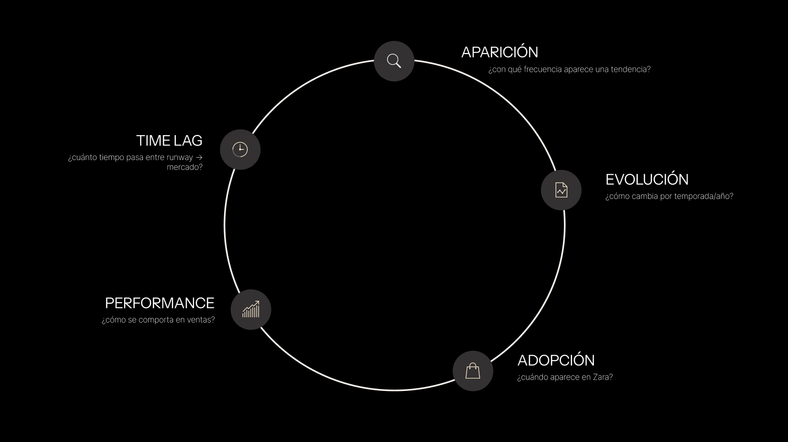
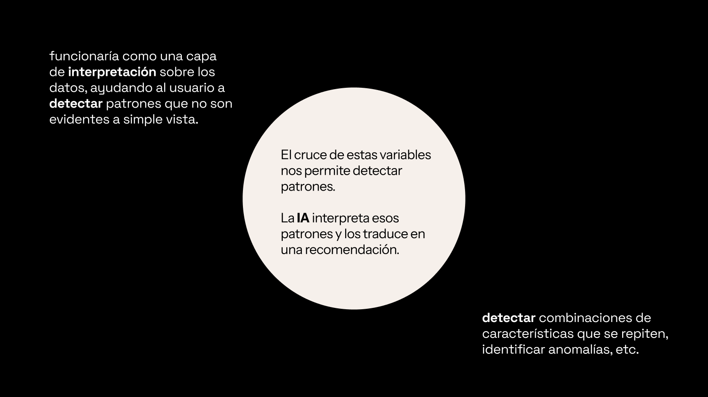
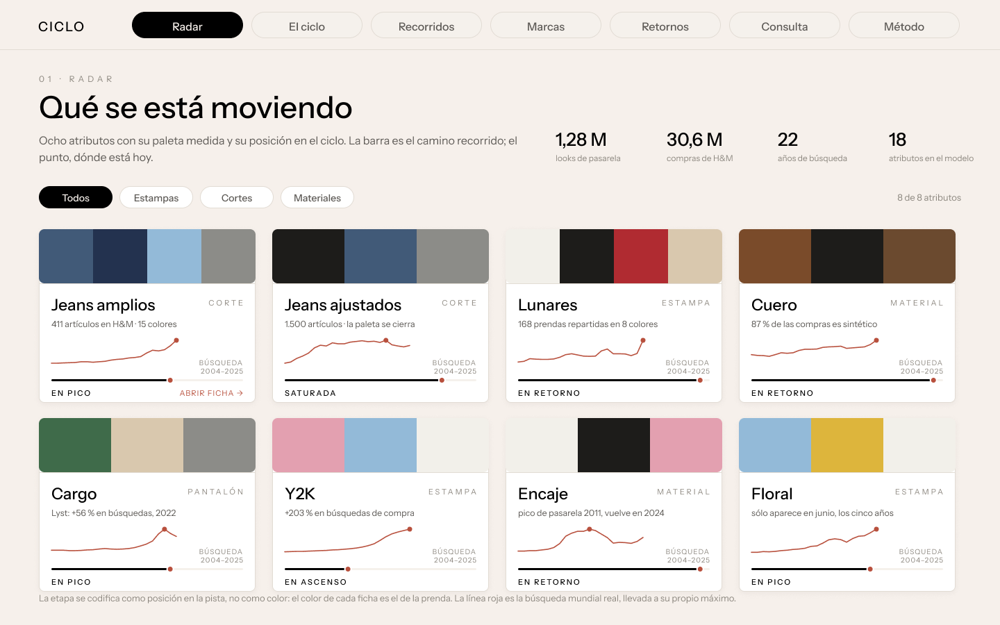
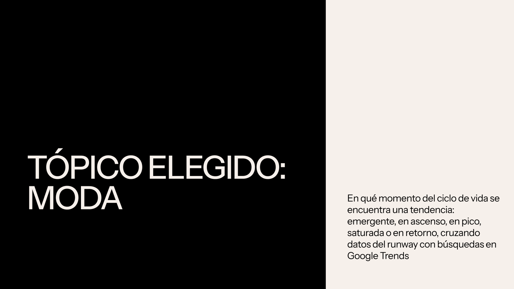

# CICLO · Racional

**Entrega 4 · 17/11/2026** · *Sistemas generativos e IA para Diseño* (K534/K576), UdeSA · Felipe Berney y Abril Dobler ·
Docentes: Cristian Reynaga e Iván Fardjoume

> **Versión del 04/11.** La redactó Claude a partir del repositorio y de las conversaciones de trabajo con Felipe en
> Claude Code (del 13/10 al 04/11). Lo que dice quién decidió qué sale de esas conversaciones y cita las palabras de
> Felipe tal como las escribió.

App: https://felipeberney-boop.github.io/ciclo/ · Repositorio: https://github.com/felipeberney-boop/ciclo ·
Figma: https://www.figma.com/design/4lvJEf2ZjBX87sXEySXqa7

Este documento no describe la interfaz: explica por qué es así. Cada sección dice de dónde sale lo que afirma, para que
alguien que no cursó pueda seguir el razonamiento y repetirlo.

---

## 1 · El problema y el contexto

**A quién le sirve.** A quien diseña ropa y tiene que comprometer una decisión antes de saber cómo le va a ir: qué
diseñar, qué mandar a producir o si algo que ya hizo sigue vigente. La decisión cambia según el tipo de marca: una de
fast fashion produce en seis semanas y su prenda tiene que leerse actual un año; una marca de autor produce en tres
meses, pero su apuesta tiene que aguantar cinco.

**Qué decisión necesita tomar.** Entrar, esperar o salir de un atributo: un color, una estampa, un corte o un material.
No «una tendencia», que no se puede contar en ningún dataset (`decisiones.md`, 01/09), ni una prenda entera.

**Cómo se decide hoy, con ejemplos reales.** La industria ya decide con informes, tableros y foros, casi todos pagos y
con métodos que no se ven desde afuera:

| Qué usan | Quién lo produce | Qué dice que da | Fuente |
|---|---|---|---|
| **Informes y briefs de tendencia** para comprar | WGSN · *Fashion Buying* (lanzado el 08/08/2024) | «Product direction, the key trends to back next, and how deeply to invest in specific styles»; briefings de materiales, estampas y color, y una proyección de color a dos años | [Comunicado de WGSN](https://wgsn.com/en/wgsn/press/press-releases/wgsn-launches-fashion-buying-dedicated-intelligence-and-forecast-led). La precisión que promete es del vendedor, sin validación pública |
| **Tablero que lee redes con visión por computadora** | Heuritech | Unos tres millones de imágenes de redes por día. Dior lo usó para una nueva versión del bolso Miss Dior, y Rabanne para ver cómo respondía el público a su bolso de 1969 | [Wallpaper, 30/12/2023](https://www.wallpaper.com/fashion-beauty/is-ai-the-future-of-fashion-trend-forecasting) |
| **Tablero de predicción sobre pasarela** | Tagwalk (lanzado en diciembre de 2024) | Colores, materiales y temas hasta un año antes, sobre etiquetas de más de 400.000 imágenes de 1.000 marcas | [Tagwalk](https://www2.tag-walk.com/fr/news/tagwalk-s-trends-prediction-dashboard-part-of-the-time-s-best-inventions-of-2025) |
| **Foros de materiales y color** | Première Vision | Las direcciones de color y tela se arman 18 a 24 meses antes de que la colección llegue a la tienda | [Première Vision](https://www.premierevision.com/articles/78f85898-1079-f111-b337-000d3a3a1397/how-are-premiere-vision-trends-created-) |
| **Tableros de surtido y precio** | EDITED | Surtido, precios, fechas de lanzamiento y tendencias de la competencia | [Harvard D3](https://d3.harvard.edu/platform-rctom/submission/data-driven-dress-dealing/index.html) y los casos de clientes de EDITED (material del vendedor) |
| **El circuito tienda → diseño** | Zara | Los encargados de tienda pasan a diario lo que piden los clientes; el diseño responde en semanas | Ferdows, Lewis y Machuca, «Rapid-Fire Fulfillment», *Harvard Business Review* 82(11), noviembre de 2004 (leído en resúmenes; conviene citar el original) |

**Por qué importa equivocarse.** BoF y McKinsey ponen el inventario en lo más alto de la agenda de la industria para
2025: sobrestock y quiebres de stock a la vez ([resumen del CFDA de *The State of Fashion 2025*](https://cfda.com/resources/sustainability-resource-hub/library-lexicon-annex/the-state-of-fashion-report-2025-mckinsey-company-and-bof-insights/)).
Una lectura de tendencias que se equivoca no queda en un informe: se convierte en prendas que nadie compra.

**El hueco que ocupa CICLO.** Esas herramientas son pagas (un informe de temporada de Tagwalk cuesta entre 2.500 y
6.000 euros según el tamaño de la empresa, según [su página de informes](https://www.tag-walk.com/en/spring-summer-2024-catwalk-report)) y muestran el resultado, no el cálculo. CICLO
trabaja con datos públicos, dice de dónde sale cada número y dice lo que no puede hacer: no predice.

**Lo que no hicimos, y por qué.** No hay entrevistas con diseñadores. El 27/10 se armó un jurado ciego (cinco a diez
personas de diseño ubicando los 17 atributos en su etapa) y se descartó el mismo día: dependía de conseguir gente que no
controlábamos («no me gusta esto de las entrevistas es un quilombo», Felipe). La validación se hizo con una fuente que el
modelo no ve, Reddit (punto 2). El costo es que este punto se apoya en cómo trabaja el mercado, con ejemplos públicos, y
no en conversaciones con quien usaría la app.

---

## 2 · La hipótesis, en una frase

> **Cruzando lo que propone la pasarela con lo que busca la gente, se puede ubicar cada atributo de moda en su etapa del
> ciclo y distinguir lo que está subiendo de lo que no; esa lectura coincide con fuentes que el modelo nunca vio.**

**Qué asumimos.** Que la etapa de un atributo se ve en dos capas a la vez: cuánto aparece en los desfiles y cuánto lo
busca la gente. Que «gana terreno» se mide contra las otras búsquedas de moda, no en valores absolutos, porque Google
crece y cambia cómo mide. Que el tipo de marca cambia qué conviene hacer con una misma etapa.

**Qué no podemos afirmar.** Que CICLO prediga: cuatro métodos de predicción no le ganan a repetir el último valor
(`hipotesis.md`). Que la pasarela adelante a la búsqueda: no lo hace ni por año ni por temporada; la prueba por
temporada se registró antes de tener los datos y se rechazó (27/10). Que la búsqueda prediga la venta: contra 5.577
productos con venta real (VISUELLE), explica el 0,1 %. Y que distinga «en retorno» de «saturada»: contra Reddit, no
lo hace (p = 0,88).

**Lo que sí está probado.** Lo que el K-means pone en ascenso o en pico es lo que más crece en Reddit, una fuente que no
usa: p = 0,0013, con el criterio fijado antes de calcular (27/10). El detalle, prueba por prueba, está en `hipotesis.md`.

**De dónde salió.** La hipótesis de la Entrega 1 prometía anticipar: «señales tempranas de los desfiles». Las pruebas
la corrigieron dos veces. La unidad pasó de «tendencia» a atributo, y el foco, de anticipar a leer el presente.

---

## 3 · Los datos y su trazabilidad

**Qué datos, para qué y cómo conviven.** En la app lo cuenta una sola pieza, arriba de todo en Método: «Cómo se arma
una lectura» (en el ítem 8). Lleva a los jeans de los datos a la señal en siete pasos.

```
ENTRAN AL MODELO                    SE CRUZAN POR                  QUÉ SALE
Pasarela · Vogue Runway  ──┐                                    ┌─ La etapa (un lugar en la pista)
Búsqueda · Google Trends ──┴──►  atributo × año  ──► K-means ──┼─ La señal (etapa + tu perfil, por una regla)
                                 (17 atributos,                 └─ El cono (hasta la ventana, con su error)
COMPRUEBAN DESPUÉS, NO ENTRAN     4 rasgos, k = 4)
Reddit · Google Shopping · Amazon · Lyst
```

**Las fuentes** (completas, con fechas de descarga y licencias, en `datasets/fuentes_y_descargas.md`):

| Fuente | Quién la produce | Cada cuánto se actualiza | Cubre | Licencia | Limitación |
|---|---|---|---|---|---|
| Vogue Runway (`traopia/vogue-runway`) | Condé Nast; el dataset lo armó un tercero en HuggingFace | No se actualiza: se scrapeó el 31/03/2023 | 1.281.633 imágenes; usamos 902.566 looks de colección, 2000–2023 | Sin licencia declarada; uso académico, sin redistribuir | Después de 2023 no hay dato; las etiquetas las puso un modelo de visión genérico |
| Google Trends | Google | Continua; exportado el 22/09 y el 20–21/10 | 65 series, mundo y 14 términos de Argentina, 2004–2024 | Términos de servicio de Google | Índice relativo, no volumen; salto de medición desde 2025, por eso se corta en 2024 |
| Reddit (Arctic Shift) | Usuarios de r/femalefashionadvice | Continua; consultado el 22/09 y el 13/10 | 4.404 posts que nombran los términos, 2012–2025 | Datos públicos, con atribución | Un solo subreddit, en inglés, sobre todo de mujeres |
| H&M, Amazon, Google Shopping | H&M (Kaggle), Amazon (McAuley Lab), Google | Fijos | 30,6 M de compras 2018–2020; 1,1 M de reseñas 2012–2023 | Kaggle académico; Amazon sin licencia declarada | Validan después; no entran al modelo |
| Lyst Index | Lyst | Trimestral | 34 trimestres, Q1-18 a Q2-26, 55 marcas | Editorial, citado | Cambió la fórmula en Q1-26: se calcula dentro de cada tramo |
| Zara 2018–22 y Mix de marcas | Kaggle | Fijos | 660 y 2.176 productos | Kaggle | **Sintéticos**: sólo muestran el método |

**La clave.** Todo se cruza por **atributo × año**. Cada atributo tiene un nombre de taller («jeans amplios») y, por
cada fuente, el término con el que se lo busca (la etiqueta de Vogue, el término de Google, la palabra en Reddit). Están
en `REC` (`app/index.html`), uno por atributo.

**Las variables que calcula CICLO.** El diccionario de las columnas crudas está en `datasets/diccionario.md`. Estas son
las que salen del cálculo:

| Variable | Qué es | Unidad y rango | Cómo se calcula |
|---|---|---|---|
| Nivel de pasarela (`pn`) | Dónde está hoy contra su propio máximo | 0 a 1 (1 = en su pico) | Proporción de looks con la etiqueta en 2022–23, sobre su máximo histórico |
| Momento de pasarela (`pm`) | Cuánto cambió | Proporción, puede ser negativa | 2021–23 contra 2018–20 |
| Nivel de búsqueda (`bn`) | Igual, en la búsqueda mundial | 0 a 1 | 2023–24 sobre el máximo hasta 2024, con la búsqueda corregida por el crecimiento general de Google |
| Momento de búsqueda (`bm`) | Igual | Proporción | 2023–24 contra 2020–21 |
| Gana o pierde terreno | Cuánto peso ganó dentro de las búsquedas de moda | Puntos, de −31 a +50 en los datos de hoy | Peso del término frente a las otras búsquedas de moda, 2022→2024 |
| Etapa | En qué punto del ciclo está | Una de cinco | K-means (abajo) |
| Ventana | Cuánto tiene que seguir actual la prenda | 1, 2, 3 o 5 años, según la categoría | Supuesto de diseño (`decisiones.md`, 13/10) |
| Error a la ventana | Cuánto se movió de verdad la búsqueda a esa distancia | ±14, ±17, ±21 o ±26 puntos | Error absoluto medio del cono, medido en 224 tramos (`codigo/calcular_cono.py`) |
| Señal | Qué conviene hacer | Entrar, Esperar o Explorar, Salir, Sin dato | Regla fija (abajo) |

**Cómo se construye cada índice.**
- **El K-means.** 17 atributos que existen a la vez en Vogue y en Google Trends (sin calzado). Cuatro rasgos: nivel y
  momento de pasarela y de búsqueda, estandarizados (z-score) para que ninguno pese más por su escala. k = 4, que
  arranca de los centroides guardados para que el resultado sea siempre el mismo. Los grupos se nombran por el
  prototipo de etapa más cercano. Una tendencia nueva se asigna al centroide más cercano y nunca reentrena el modelo:
  hacerlo convertía a cada tendencia nueva en su propio grupo y les cambiaba el nombre a los demás (22/09). Con la
  búsqueda hasta 2024, la silhouette ya no prefiere k = 4 (0,373 contra 0,387 con k = 2); nos quedamos con 4 porque
  con menos grupos las etapas no se separan, y la pantalla del modelo lo dice (20/10).
- **La señal.** Si el atributo tiene etapa del K-means, decide la regla de CICLO para la categoría (`CONSEJO`): con un
  atributo en pico, fast fashion entra y una marca de autor sale. Si no tiene etapa pero tiene serie, decide si gana o
  pierde terreno (más de 3 puntos). Si no tiene nada, queda sin dato: es neutro, porque «no tengo datos» no es lo
  mismo que «está cayendo». Si diseñás por tu cuenta, donde la regla dice Esperar dice Explorar.
- **El cono.** Desde el último dato bueno, cada curva sigue la mediana de lo que pasó en la historia a esa distancia,
  con una banda donde cayó el 60 % y el 90 % de los casos. No es un pronóstico: en las pruebas empata con repetir el
  último valor en la pasarela (20,9 contra 20,9) y apenas mejora en la búsqueda (11,4 contra 12,6), y por eso la
  pantalla lo dice (13/10).

**Cómo se interpretan los colores.** El color dice una sola cosa: si conviene avanzar o frenar. Verde es Entrar, ámbar
es Esperar o Explorar, rojo es Salir, siempre con la palabra y un ícono (▲ ■ ▼), y lo que no tiene dato queda en gris.
La etapa no tiene color: es una posición en la pista. De dónde sale un dato tampoco tiene color: ● medido, ◇
interpretado, ↪ prestado de un pariente. El azul significa sólo «se puede tocar». Los grupos del K-means usan tonos que
no se confunden con la señal.

**El repositorio.** Decisiones fechadas en `decisiones.md`, versiones en `historial.md`, fuentes en
`datasets/fuentes_y_descargas.md`, diccionario en `datasets/diccionario.md`, prompts versionados en `prompts/`. Los
datos crudos no están (pesan demasiado o necesitan cuenta); están los links y lo calculado.

---

## 4 · El modelo: qué entra, qué se calcula, qué sale

```
ENTRA                                   SE CALCULA                                  SALE
Pasarela por atributo y año  ─┐         nivel y momento (4 rasgos)                  la etapa
Búsqueda por atributo y año  ─┼──────►  z-score → K-means k=4 → nombre de etapa ──► la señal, con la categoría
Tu perfil (público,           │         regla CONSEJO × categoría × vínculo         el cono, con el error a tu ventana
  vínculo, categoría)        ─┘         mediana histórica a h años
Una foto (opcional)          ────────►  CLIP: parecido con 14.000 looks            atributos que ve y looks parecidos
Una pregunta (opcional)      ────────►  LLM con métricas ya calculadas             una lectura marcada ◇ interpretación
```

**La IA, dónde entra y dónde no.** CLIP (ViT-B/32) lee imágenes: etiquetó la pasarela y, en el navegador, compara la
foto que sube la persona con 14.000 looks; acierta el atributo entre los tres primeros entre el 67 % y el 92 % de las
veces según el atributo, en 150.000 looks que no vio. El modelo de lenguaje (Groq, `gpt-oss-120b`) **nunca ve una fila
de datos**: recibe métricas ya calculadas y las traduce, y lo que dice aparece marcado como interpretación. La etapa y
la señal no las decide la IA: las deciden el K-means y una regla fija.

**Qué quedó afuera y por qué.**
- **La predicción.** Se probó de cuatro maneras y con un modelo global; ninguna le gana a repetir el último valor.
- **2025 y 2026 en la búsqueda.** Google cambió la medición: en 2025, 15 de 16 series suben y 12 tocan su máximo.
- **El calzado.** Dos de ocho estilos tienen señal en la búsqueda; CLIP lee la ropa, no el zapato. Está contado como
  resultado, no escondido (26/10).
- **Pasarela y venta por género.** Vogue y los agregados de H&M no traen esa columna; está declarado en Método.
- **Lo emergente.** Ningún atributo del set está empezando: haría falta pasarela posterior a 2023.

---

## 5 · El usuario y el flujo

**El perfil.** En la Entrega 1 la cátedra pidió que dejara de ser genérico; pasó a ser una forecaster independiente
que asesora a varias marcas. Desde el 13/10 es quien diseña, porque la app dejó de mostrar todo y pasó a acompañar una
decisión de diseño.

**El recorrido.** Tres preguntas → Tendencias → la ficha de un atributo → «Diseñar con…» → Preguntar. Está
paso a paso, con capturas, en el readme, y en papel, una pantalla por hoja, en
`entregas/entrega_4/disenos_en_papel/`.

**Por qué la ramificación es así.** Tres preguntas: ¿para quién diseñás? (mujer, hombre, sin género), ¿trabajás para
una marca o por tu cuenta?, y la categoría. La del vínculo viene de una devolución del 13/10 (`decisiones.md`). En la
Entrega 3 la cátedra preguntó si esas eran las mejores palabras para ramificar, y lo pusimos a prueba.

**La alternativa que probamos y descartamos.** El 04/11 la entrada pasó a preguntar por el objetivo: «¿Qué estás por
decidir?», con Qué diseñar, Qué producir y Si algo ya pasó. Salió de evaluar tres variantes:

| Variante | La pregunta | Por qué no o por qué sí |
|---|---|---|
| El alcance | Una colección · Una prenda · Si algo sigue vigente | Colección o prenda no cambia ningún número: habría que inventar ventanas |
| El compromiso | Qué diseñar · Qué producir · Si algo ya pasó | La que se construyó: en la app, en papel y en el recorrido del readme |
| El plazo | ¿Para cuándo en tienda? · ¿Cuánto tiene que durar? | Da la ventana directo, pero pierde el posicionamiento y obliga a reescribir las reglas |

Al usarla, no funcionó. Obliga a la persona a traducir su situación a una categoría abstracta antes de haber visto nada
de la app, y eso la frena en la primera pantalla: no se entendía qué elegir. El mismo día volvimos al vínculo laboral.

**Por qué el vínculo.** Es una pregunta que un diseñador contesta sin pensar. Y lo que de verdad cambia la lectura se
deduce mejor de las respuestas que ya tiene la entrada que de una pregunta por el objetivo. Cuánto cuesta equivocarse
sale del vínculo: quien trabaja por su cuenta no compromete producción ni stock, así que donde a una marca le conviene
Esperar, a esa persona le conviene Explorar, empezar a diseñar sin comprometer la serie. Cuánto falta hasta que la
prenda se produce, y cuánto tiene que durar, salen de la categoría. Lo que Cristian criticó no era la pregunta sino el
texto de más dentro de cada cuadrado, y ese texto ya se había sacado el 03/11.

**La categoría se queda**, y esto no era obvio: se pensó que el lead time la podía reemplazar. No puede. La categoría
lleva dos cosas que el lead time no tiene: la ventana (de la que depende el error medido, porque los lead times son
todos menores a un año y el error se mide año a año) y el posicionamiento (en pico, fast fashion entra y una marca de
autor sale, aunque la de autor tenga un lead time más corto que high fashion). Las categorías cambian según la rama:
para una marca, high fashion, contemporary, fast fashion y de autor; por tu cuenta, el tipo de prenda que querés
diseñar.

Después de las tres preguntas la app abre en Tendencias, con el perfil escrito arriba y «Cambiar» al lado.

---|---|---|
| El alcance | Una colección · Una prenda · Si algo sigue vigente | Colección o prenda no cambia ningún número: habría que inventar ventanas |
| **El compromiso** | **Qué diseñar · Qué producir · Si algo ya pasó** | **Elegida.** Es el objetivo de la persona, conserva todo lo que la lectura usa y agrega mirar hacia atrás |
| El plazo | ¿Para cuándo en tienda? · ¿Cuánto tiene que durar? | Da la ventana directo, pero pierde el posicionamiento y obliga a reescribir las reglas |

**La categoría se queda**, y esto no era obvio: se pensó que el lead time la podía reemplazar. No puede. La categoría
lleva dos cosas que el lead time no tiene: la ventana (de la que depende el error medido, porque los lead times son
todos menores a un año y el error se mide año a año) y el posicionamiento (en pico, fast fashion entra y una marca de
autor sale, aunque la de autor tenga un lead time más corto que high fashion).

Cada respuesta lleva a un lugar distinto: Qué diseñar entra a Diseñar; Qué producir, a Tendencias; Si algo ya pasó, a
Tendencias con la pregunta «¿Sigue vigente?» y lo que ya hay que dejar primero.

---

## 6 · Las decisiones de diseño

**Lo más importante de cada pantalla.**

| Pantalla | Lo primero que se ve | Por qué |
|---|---|---|
| La entrada | Una pregunta y sus opciones, nada más | Cada respuesta cambia la lectura; lo que cambia está en Método |
| Tendencias | Qué gana y qué pierde terreno: dos gráficos que se dibujan solos (hasta el 10/11, un bloque oscuro de texto que la devolución marcó como obstructivo) | Es lo que se mueve hoy, medido; después, cada atributo con su etapa y su señal. Sólo lo que tiene dato medido: el catálogo sintético no se muestra |
| La ficha | La señal grande, con una línea de por qué | Es la decisión. El gráfico la sostiene; el detalle está en el «?» |
| Diseñar | La pregunta del paso | Un paso, una decisión; lo elegido queda en una barra abajo |
| Preguntar | La conclusión, en una frase | La devolución pidió filtrar lo que devuelve la IA: abajo va el dato que la sostiene, y el detalle queda plegado |
| Método | «Cómo se arma una lectura»: de los datos a la señal, animado | La devolución pidió que se entienda qué datos se usan y cómo conviven, sin tener que leer |

**Cómo se jerarquizó.** Tres grupos para cada bloque de texto: lo que se necesita para decidir se queda; lo que aclara
cómo usar la app pasa a un «?» que se abre si lo tocan; lo que no aporta se borra (`decisiones.md`, 04/11).

**Tipografía.** Había 31 tamaños de letra y 49 combinaciones de tamaño y peso (medido). Quedan cinco, con un peso por
tamaño: Título 48, Subtítulo 24 y Dato 34 en Semi Bold; Cuerpo 17 y Etiqueta 13 en Regular. Es la tipografía del
sistema (SF Pro en Apple, Inter en el resto), porque la referencia que pasó la cátedra (el sistema de diseño de Apple)
hace que la interfaz se corra y la ropa hable. Cinco estilos hacen que el tamaño signifique algo: si es grande, decide.

**Color.** El de las prendas, que es el dato que la persona vino a ver; la señal, con su palabra; y un solo azul para lo
que se toca. Nada más tiene color, y por eso la señal se ve.

**Grilla.** El contenido va hasta 1.360 px, con un margen que va de 16 px en el celular a 80 px en la compu, y las
tarjetas se acomodan solas, de 268 px como mínimo. En el celular todo va en una columna y los gráficos anchos se
deslizan. No es una grilla de columnas fija: es fluida, porque la cantidad de tarjetas cambia con el perfil y con el
filtro, y una grilla de 12 columnas dejaría huecos. Las hojas en papel usan la misma regla.

---

## 7 · El recorte de alcance

Ropa, no calzado ni accesorios (sin señal medible). Leer el presente, no predecir (refutado). Mundo y Argentina sólo en
la búsqueda (no hay pasarela local). Sin separar por género (las fuentes no lo traen). Y menos pantallas a la vista: el
04/11 «Más» pasó de cinco a dos (Adiviná vos y Método) y Retornos se abre desde El ciclo, donde se usa. El 10/11, El
modelo y Marcas salieron de la navegación: no ayudaban a tomar una decisión, y lo que explicaban lo cuenta ahora la
pieza de Método.

---

## 8 · El proceso y el uso de IA

**Los bocetos previos.** Lo primero que hizo el grupo está en Figma, con fecha. Las imágenes, exportadas de esos
archivos, están en `entregas/entrega_4/bocetos_previos/`.

| Fecha | Qué | Dónde |
|---|---|---|
| 25/08 | **Entrega 1**: la pregunta, la hipótesis, el usuario, qué medir y dónde entra la IA, y los referentes (Pinterest, Google Trends, Spotify) | [Figma Slides](https://www.figma.com/slides/naASEKNbarWxFM4GKZFUuY) |
| 05/10 | **Entrega 2**: el prototipo navegable, diez pantallas en escritorio y celular (portada, radar, la ficha, el ciclo, recorridos, marcas, retornos, consulta y método) | [Figma](https://www.figma.com/design/zpHKE7YQLBRXJPcbyrb37I) |

| | |
|---|---|
|  |  |
| *25/08 · Qué medir: aparición, evolución, adopción, performance y time lag, en un círculo. Es el antecedente de El ciclo.* | *25/08 · Dónde entra la IA: «interpreta esos patrones y los traduce en una recomendación».* |
|  |  |
| *05/10 · El radar del prototipo: tarjetas con la paleta, la serie y la etapa como posición en una pista. Las tres ideas siguen en la app.* | *25/08 · La pregunta: en qué momento del ciclo está una tendencia, cruzando pasarela y búsqueda. Las cinco etapas son las de hoy.* |

Dos aclaraciones, para que no se lea más de lo que es. La Entrega 1 no tiene pantallas: son láminas de ideas. Y el
prototipo de la Entrega 2 ya convivía con la IA: el sitio de esa entrega era un artifact de Claude
(`entregas/entrega_2/readme.md`), y según `decisiones.md` (05/10) empezó con wireframes esquemáticos que se reemplazaron
por pantallas con los datos reales; esos wireframes no quedaron en el Figma. Tampoco es un boceto previo
`diseno/prototipos/prototipo_felipe_1/` (13/10): la imagen la hizo Claude, a pedido de Felipe («haceme una imagen de
ejemplo de como se veria la web»), sobre una captura de la app que ya estaba en código.

**Las etapas.**

| Fecha | Qué | Quién |
|---|---|---|
| 25/08 | Entrega 1: pregunta, hipótesis, usuario, datasets, referentes | El grupo (Abril, Felipe y Zoe, que dejó el grupo el 26/10) |
| 01/09 → 05/10 | La unidad pasa a ser el atributo, los datasets iniciales resultan sintéticos, K-means con k = 4, el prototipo de la Entrega 2 | El grupo, con Claude en el chat. De esas conversaciones no hay registro en el repositorio: lo que queda es `decisiones.md` |
| 13/10 → 03/11 | La app en código, con Claude Code. Las devoluciones de la cátedra la cambian tres veces (13/10, 27/10, 03/11) | Felipe decide y pide; Claude propone, prueba y escribe el código. Felipe también trabajó con Claude en otra copia del repositorio y trajo de ahí consignas y cambios (13/10) |
| 04/11 | La entrada por la decisión, probada y descartada; el papel, cinco estilos de texto, la curaduría, la pirueta, la app sin la firma de la materia | Felipe eligió sobre variantes de Claude; lo que delegó está dicho abajo |
| 10/11 | La devolución de la Entrega 3, con notas: el chat contesta primero, «Cómo se arma una lectura» reemplaza al esquema, El modelo y Marcas salen de la navegación | Felipe fijó el criterio («no agregamos nada. Sacamos») y eligió; Claude corrigió la pieza contra el modelo, la construyó y la probó |

**Qué propuso la IA, qué decidió Felipe y por qué.** Las citas de Felipe son textuales, de las conversaciones en Claude
Code. Las consignas largas que pegó (el 20/10, el 27/10, el 03/11, el 04/11 y el 10/11) cuentan como suyas: las eligió y las mandó.

| Tema | La IA propuso o hizo | Lo que decidió Felipe | Por qué |
|---|---|---|---|
| Los datos hasta hoy (13/10) | Completar Reddit con dato real hasta octubre de 2026 y proyectar la pasarela marcada, fuera del K-means. No inventar H&M ni Amazon | Lo pidió: «quiero que lo sigas hasta hoy en dia [...] busca la data que falta o predicila segun los datos antiguos». Aceptó que lo proyectado no entrara al modelo | El mejor de 21 métodos casi no le gana a repetir el último año: clasificar con eso sería contestar con lo que no sabemos |
| Hasta 2030 (13/10) | Las líneas llegan a 2030, pero como cono: no es un pronóstico, y la pantalla lo dice | Lo pidió: «que la linea de las tendencias vayan hasta 2030 asi el disenador puede ver el futuro» | Cuatro métodos no le ganan a repetir el último valor |
| 2025 (13/10) | Primero sacó 2025 por el salto de Google. Después propuso leer la búsqueda contra las otras búsquedas de moda | Lo frenó: «porque sacaste 2025? no es hasta hoy en dia ?». Después: «si, hacelo así». El 20/10 su consigna cortó todo en 2024, porque 2026 también estaba contaminado | En 2026, 39 de 40 series saltaron a la vez y el ancla, el trench, picó en abril en lugar de octubre |
| Qué construir (13/10) | Siete ideas de función y seis de interfaz | Eligió: «hacé la consulta por imagen con CLIP y pushealo, despues hace links compartibles» | Buscar por imagen es lo que hace distinta a la app |
| Diseñar, paso a paso (13/10) | Lo construyó. Avisó que no hay dato real de color de venta, y los colores se miden en la pasarela con CLIP, marcados como interpretación | La idea es suya: «primero elige una prenda [...] despues clicke en baggy pueda elegir el color [...] vos tenes el mando y la app te va remendando» | La app tenía que acompañar una decisión de diseño, no mostrar todo |
| Las preguntas de entrada (13/10) | Las construyó | La idea es suya: «de que pais sos y para quien queres disenar (tu publico) eso tiene que estar en las preguntas al principio» | «que no sea un mar de caos de informacion» |
| Los nombres y los dibujos (13/10 y 14/10) | Llevó los nombres a toda la app y puso las siluetas | Lo pidió: «jeans baggy y [...] jeans skinny, cada corte por su nombre posta». Mandó las siluetas y fijó: «o todas ilustraciones o todas imagenes, que no sea una mezcla» | Un nombre que no se dice en un taller no va en la interfaz |
| Preguntar, el LLM (20/10) | El diseño: los datos se generan desde la app (`ciclo_datos.md`) y van sólo las fichas que nombra la pregunta, por el límite de tokens de Groq | Pidió que pensara las dos cosas: «1 como va a funcionar [...] 2 como va a hacer esa fuente de datos» | El LLM nunca ve una fila de datos |
| Mom y boyfriend (14/10 → 20/10) | Listó «mom» como un corte de jean más, al lado de baggy y skinny | Lo corrigió en su consigna: «Sacá «mom jeans» y «boyfriend»». Quedan como alias de búsqueda, invisibles en la interfaz | No son cortes: mom es tiro alto y pierna recta relajada, boyfriend tiro medio y pierna tapered |
| El semáforo (20/10 y 27/10) | Lo implementó con una sola función, `señal()`, que decide todo el color | Las reglas son de sus consignas: Entrar verde, Esperar ámbar, Salir rojo, y la procedencia fuera del canal color. Y después: «gana presencia que aprazca en verde la letra y la flechita», «pone pierde presencia en rojo tambien» | El color volvía mal porque lo decidían tres partes del código por separado |
| El estilo (27/10) | Tres variantes: revista, revista suave (la que recomendó) y estudio | Ninguna: «no me gustaron, el profe sigue diciendo que es muy IA [...] decidi la de apple». Después, «me gustaron las blancas». Que quede siempre en claro lo interpretó Claude | Tres variantes no convencieron; la referencia vino de la cátedra |
| El calzado (20/10 → 26/10) | Dos pruebas, con Google Trends y con CLIP en la pasarela, las dos sin señal | Fue y vino, y está dicho: «no va a hber calzado en nuestra app» (20/10), «mandame de calzado tambien ya fue» (20/10), su consigna «no agregues Accesorios ni Calzado» (21/10), y al final «deja calzado pero mostra lo que tengamos» (26/10) | Lo que no se mide se dice, no se esconde |
| La hipótesis (27/10 y 03/11) | Un jurado ciego, Lyst y el adelanto mes a mes. Se negó a reescribirla para que diera sí: «Si la ajustamos después de ver el resultado [...] pierde valor». Después propuso Reddit | Preguntó: «porque no se comprueba mi hipotsis y como hacemos para que se compruebe». Descartó el jurado («es un quilombo», «borrar el formulario») y eligió Reddit. El 03/11: «que sea mas positiva [...] centrate en lo que si tenemos» | Reddit no entra al modelo y no depende de conseguir gente |
| Tendencias primero (26/10) | Lo implementó | Lo decidió: «que aparezca primero tendencia [...] disenar es un festure de la app pero lo main thing es que puedas ver que esta en tendencia» | Lo que se mueve hoy es la puerta de entrada |
| La presentación (27/10 y 03/11) | La armó y la redujo | Lo decidió: la web como pieza principal, «sacar la presentacion emtrega 3 figma slides», y «saca todos los slides que el profe no pida» | Una sola pieza, como la referencia de la cátedra |
| La ramificación (04/11) | Tres variantes; recomendó «el compromiso» y cambiar «Si algo sigue vigente» por «Si algo ya pasó» | Su consigna planteó la pregunta por la decisión y eligió la variante 2 («si hace»). Al usarla la descartó el mismo día: «no funciona. Es confusa y no se entiende qué elegir. Sacala», y volvió al vínculo | Obligaba a traducir la situación a una categoría abstracta antes de ver la app; el vínculo se contesta sin pensar |
| Tipografía y curaduría (04/11) | Midió 31 tamaños y propuso cinco estilos; clasificó cada texto en se queda, va al «?» o se borra | Lo pidió en su consigna y quiso ver la lista antes de borrar; después dio control: «tenes full control» | La devolución de Cristian: demasiados estilos y capas que no aportan |
| La pirueta (04/11) | Recomendó «Adiviná vos» con el LLM como jugador. Al construirla, sacó al LLM | Las dos ideas son suyas; eligió la primera: «si hace». Lo del LLM lo decidió Claude | Para jugar, el LLM tendría que ver la serie, y en CICLO no ve filas de datos |
| La app como producto (04/11) | La lista de lo que sólo tenía sentido en la cursada: el catálogo sintético en Tendencias, el laboratorio del K-means arriba de todo, textos que le hablaban a quien evalúa, la presentación dentro del sitio | El criterio es suyo: «esto es una app, no una entrega», «nada de números de entrega, criterios de evaluación, nombres de docentes». Pidió ver la lista antes y después la delegó: «hace todo lo que te parezca hacer en la lista» | Quien entra tiene que ver un producto; el rigor (fuentes, límites, pruebas) se queda |
| Las pantallas de «Más» (04/11) | El modelo y Marcas desde Método, Retornos desde El ciclo | Lo delegó: «hace lo que te parezca» | El menú ofrecía cinco cosas iguales; tres eran detalle de otra |
| La segunda pirueta (10/11) | Leyó la propuesta contra el modelo: «las cinco capas se combinan en una señal» no era cierto (entran dos; las otras comprueban) y la pasarela de los jeans es prestada. Propuso la versión honesta y que reemplazara al esquema de Método | La idea es suya, y el criterio también: «Para la Entrega 4 no agregamos nada. Sacamos.» Aprobó la corrección: «sí a las dos» | La devolución pedía entender cómo conviven los datos; una pieza que exagera las capas habría contradicho al modelo |
| El chat filtrado (10/11) | El prompt v7: conclusión, dato y detalle plegado. En la prueba encontró lo que el prompt no alcanzaba y lo filtró en la app | El formato es suyo: «una conclusión primero, en una frase; después el dato que la respalda; y recién al final, si hace falta, el detalle, plegado» | La devolución: «tengo que leer muchas cosas que no aportan valor por igual» |
| La tercera pirueta (10/11) | Propuso «¿Tenés ojo?»; descartada, pensó «El brief» para diseñadores, lo construyó y verificó las jugadas mínimas | Descartó la primera («es literal un memo test») y pidió «que el juego sea divertido para diseñadores» | La devolución: la pirueta anterior no era un juego |
| El modelo y Marcas (10/11) | Propuso sacarlas de la navegación: ninguna ayuda a tomar una decisión | Lo aprobó: «sí a las dos» | Cada pantalla tiene que poder decir en una frase qué decisión ayuda a tomar |

**Qué modelos usamos.**

| Para qué | Modelo |
|---|---|
| Escribir el código, analizar los datos, redactar | Claude: en el chat hasta la Entrega 2, en Claude Code desde el 13/10 |
| Leer imágenes: etiquetar la pasarela y Buscar por imagen | CLIP ViT-B/32 (en el navegador, sin servidor) |
| Preguntar y la lectura en vivo | Groq, `openai/gpt-oss-120b` (antes Llama, hasta que Groq lo dio de baja) |
| Propuestas de pantalla del 13/10 (Abril) | La herramienta integrada de imágenes (prompts en `prototipo_abril_1/prompts.md`) |
| Figma: el sistema implementado y el papel | El MCP de Figma |

**Cómo gestionamos el system prompt.** Cada prompt vive en `prompts/` con su versión. Nunca se pisa una versión: si
cambia, se agrega la siguiente con qué cambió y por qué (la lectura usa la v4 y Preguntar la v7; las v5 y v6 se descartaron con la entrada por el objetivo). La regla que los
atraviesa a todos es que el modelo no ve una fila de datos: los datos que recibe se generan con
`codigo/armar_datos_llm.js` a partir de la app, y van sólo las fichas que nombra la pregunta. Las claves no están en el
repositorio: cada persona pega la suya y queda en su navegador.

**La pirueta: «El brief».** La devolución de la versión del 10/11 fue directa: «Cómo se arma una lectura» no era un
juego, no tenía hook ni era interactiva. «El brief» lo es. Cada ronda es el pedido de un cliente, con la tensión del oficio
de diseñar: querer algo en el momento justo de su ciclo («necesito floral, pero que se esté vendiendo ya»). La persona
tiene cuatro movidas: sacarlo en su desfile, que lo use una it-girl, sacarlo de la colección o mandarlo a liquidación.
Cada una cambia los datos reales de los últimos años (la pasarela o la búsqueda, ×1,5 o ×0,6). El modelo vuelve a
ubicar el atributo en vivo: la curva se estira, los cuatro números corren y la ficha se desliza por la pista de etapas.
Menos movidas, más estrellas; al final, los cinco briefs arman una colección. Mientras juega, aprende cómo lee el modelo:
Pico es búsqueda alta, la pasarela sola satura, En retorno es que la suelten las dos. Los números se recalculan con la
cuenta del modelo y el atributo se asigna al grupo más cercano sin reentrenar. Las cinco jugadas mínimas se verificaron
probando todas las combinaciones. La primera propuesta, «¿Tenés ojo?», adivinar la etapa de una tarjeta, la descartó
Felipe antes de construirla («es literal un memo test») y pidió pensarla para diseñadores. La idea y la construcción
son de Claude (`decisiones.md`, 10/11).

**«Cómo se arma una lectura».** Fue la pirueta entre el 10/11 y la devolución, y queda arriba de todo en Método. Las dos notas más bajas de la Entrega 3 (datos e
IA, 5 sobre 10) decían lo mismo: el modelo es demasiado complejo para explicarlo. La pirueta convierte esa debilidad en la
pieza más clara de la app. Toma un atributo, los jeans, y en siete pasos animados, sin texto que leer, muestra cómo se
arma una lectura: entra la pasarela, entra la búsqueda, cada curva se vuelve dos números, los tres cortes se comparan
con los otros 14 atributos en la misma escala, el K-means junta a los que se parecen, cada grupo toma el nombre de su
etapa y el perfil la vuelve señal. Muestra algo que antes no se veía: la pasarela de los tres jeans es la misma (Vogue
mide «denim», no el corte), así que toda la diferencia entre el baggy (Pico, Entrar) y el skinny (Saturada) sale de la
búsqueda. Está hecha con las mismas funciones que la app, así que no puede contradecirla.

*Qué capacidad de IA usamos.* Dos, y se ven trabajando: CLIP (visión y lenguaje), que convierte las fotos de pasarela
en una serie por atributo, y el K-means (aprendizaje no supervisado), que agrupa sin que nadie etiquete. *Para qué.*
Para que la etapa salga de los datos y no de nuestra opinión. *Dónde frenamos.* La idea original decía «las cinco capas
se combinan en una señal», y la corregimos antes de construirla: al modelo entran dos fuentes, y las otras cuatro sólo
comprueban, así que van aparte y sin animar. El modelo de lenguaje no narra la pieza, porque tendría que ver las series
y en CICLO nunca ve una fila. Y la pieza termina en la etapa: el paso a la señal es una regla escrita, no IA. La idea
y la elección son de Felipe; la corrección de las cinco capas, de Claude (`decisiones.md`, 10/11).

**Antes, «Adiviná vos».** Fue la primera pirueta (04/11) y sigue en la app por su link (`#adivina`): la
persona dibuja cómo sigue una curva real de búsqueda desde 2019 y la compara con lo que pasó, con el cono de CICLO y con
repetir el último valor. En las 65 series, el último valor gana 45 a 18. Se reemplazó como pirueta porque muestra el
límite del modelo pero no responde a lo que pedía la devolución.

**Lo que devuelve la IA, filtrado.** La devolución dijo que no había filtro sobre lo que devuelve el chat. Desde el
10/11 (prompt v7) la respuesta llega en tres partes con tres pesos: la conclusión en una frase, el dato que la
sostiene y, plegado, el detalle. El prompt pide el orden y el límite de palabras; lo que el modelo igual se saltea (un id
en el texto, la señal repetida) lo filtra la app antes de mostrarlo. Probado con seis preguntas reales, sin editar, en
`datasets/pruebas/asistente_v7_respuestas.md`.

**Dónde frenamos a la IA.** No decide la etapa ni la señal. No inventa respuestas en las capturas: Preguntar se muestra
vacío. No predice: el cono dice «no es un pronóstico». Y no es la autora de las decisiones: propone variantes, y la
elección, con su porqué, queda registrada. Hubo veces en que se la frenó de verdad: cuando sacó 2025 sin avisar, cuando
sus tres estilos «parecían IA», y cuando su prueba dependía de entrevistas. Y una vez se frenó sola: no reescribió la
hipótesis para que diera sí.
