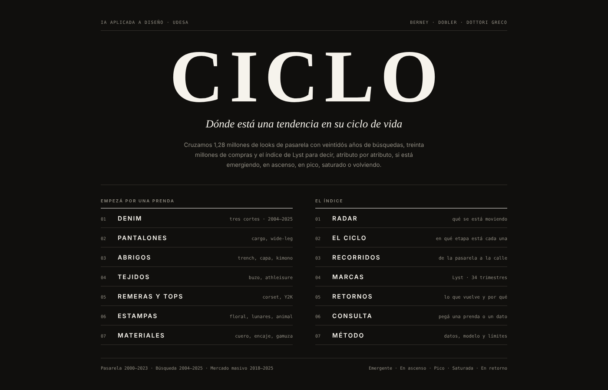

# CICLO

Web app que ubica atributos de moda —un color, una estampa, un corte, un material— en una de cinco
etapas de su ciclo de vida: **emergente, en ascenso, en pico, saturada o en retorno**.

Materia: *Sistemas generativos e IA para Diseño* (K534/K576) · Universidad de San Andrés · 2º semestre 2026
Docentes: Cristian Reynaga e Iván Fardjoume

## Integrantes

- Felipe Berney
- Abril Dobler
- Zoe Dottori Greco

## Link al sitio

| | |
|---|---|
| App publicada | https://claude.ai/artifact/7ZaJ8dZFvqaykZxTnn38Ec |
| Netlify | *pendiente — se publica la carpeta `app/`* |

## Captura



Más capturas en `entregas/entrega_2/capturas/`.

## Hipótesis

Cruzando lo que la pasarela propone con lo que la gente busca y lo que el mercado masivo vende, se
puede ubicar cada atributo de moda en una etapa de su ciclo de vida. Y se puede hacer **sin que nadie
etiquete las etapas a mano**: el modelo agrupa los atributos que se mueven parecido y recién después
nosotros leemos qué etapa es cada grupo.

La unidad de análisis es el **atributo**, no la prenda ni «la tendencia»: es lo único que se puede
contar en las cinco capas a la vez.

## Cómo correrlo

No tiene build ni dependencias. La carpeta `app/` es un único archivo HTML.

```bash
cd app
python3 -m http.server 8000
```

En Netlify: *publish directory* = `app`, sin comando de build.

Lo único que carga de afuera son las tipografías (Google Fonts: Archivo, Bodoni Moda, IBM Plex Mono).
Sin conexión funciona igual, con las tipografías del sistema.

## Las pantallas

| | |
|---|---|
| Portada | Dos entradas: por prenda o por el índice |
| Radar | Los atributos con su paleta medida y su posición en el ciclo |
| Detalle | El recorrido de un atributo por las cuatro capas |
| El ciclo | K-means sobre 18 atributos, con validación |
| Recorridos | De la pasarela a la búsqueda, y los jeans por corte |
| Marcas | Lyst Index, 34 trimestres |
| Retornos | Qué vuelve y cada cuánto |
| Consulta | Subir una prenda y recibir su etapa |
| Método | Fuentes, recortes y límites declarados |

## Fuentes de datos

Los datasets originales **no están en el repositorio**: superan el límite de GitHub o requieren cuenta
para descargarlos. En `datasets/fuentes_y_descargas.md` está el link de descarga, la fecha en que lo
bajamos y la licencia de cada uno. En `datasets/diccionario.md`, qué significa cada columna.

| Capa | Fuente | Volumen usado | Período |
|---|---|---|---|
| Pasarela | Vogue Runway | 902.566 looks de colección | 2000–2023 |
| Búsqueda | Google Trends | 49 términos | 2004–2025 |
| Compra | Google Shopping | 25 términos | 2008–2025 |
| Redes | Reddit vía Arctic Shift | 4.404 posts de r/femalefashionadvice | 2012–2025 |
| Marcas | Lyst Index | 34 trimestres, 55 marcas | Q1-18 a Q2-26 |
| Alfombra roja | Launchmetrics | Met Gala 2025 | 2025 |
| Venta masiva | H&M Personalized Fashion Recommendations | 30.570.975 compras de adulto | 2018–2020 |
| Reseñas | Amazon Reviews | 1,1 M de reseñas | 2012–2023 |
| Catálogo | Zara feb-2024 + Wish 2020 | 1.593 productos | 2020–2024 |

Las series ya procesadas que usa la app están en `datasets_procesados/`.

## Dónde interviene la IA

Seis puntos. Tres corren una sola vez, en batch; tres se disparan con el usuario.

| | Momento | Técnica | Cuándo |
|---|---|---|---|
| IA-1 | Etiquetado de pasarela | Modelo de visión | batch |
| IA-2 | Enlace de registros entre las 8 fuentes | Comparación de pares + clasificación | batch |
| IA-3 | Agrupar atributos | K-means no supervisado, k=4 | al cargar |
| IA-4 | Ubicar una tendencia nueva | Asignación al centroide más cercano | en vivo |
| IA-5 | Leer y recomendar | LLM (Groq) con prompt RACE | en vivo |
| IA-6 | Consulta por imagen | CLIP en el navegador: zero-shot + looks parecidos | en vivo |

**La regla que atraviesa todo:** el modelo de lenguaje nunca ve una fila de la base. Recibe métricas ya
calculadas —nivel, momento, crecimiento, distancia al pico— y el tipo de cliente. Todo lo que devuelve
aparece en la interfaz marcado como interpretación. Los prompts están versionados en `prompts/`.

**Claves de API:** no hay ninguna en el repositorio. La clave de Groq se configura como variable de
entorno en Netlify (`GROQ_API_KEY`). El `.gitignore` bloquea `.env` y similares.

## El modelo

K-means sobre 18 atributos que existen a la vez en la pasarela y en Google Trends, con cuatro variables
estandarizadas: nivel y momento en pasarela, nivel y momento en búsqueda.

`k = 4` por silhouette (0,326, el mejor entre k=2 y k=5). Con k=6 sube apenas (0,336) pero aparecen
grupos de un solo atributo que no dicen nada.

Los grupos que encontró, leídos como etapas:

- **En ascenso** — Y2K
- **En pico** — Jeans amplios · Jeans medios · Buzo/hoodie · Floral · Capa · Trench · Cargo · Blazer oversize
- **En retorno** — Lunares · Cuero · Animal print · Encaje · Cuadros · Piel · Zapatilla chunky
- **Saturada** — Jeans ajustados · Kimono

Validado contra dos capas que el modelo no usó: reseñas de Amazon (2019→2022) y Google Shopping
(2021-22→2024-25). Los jeans ajustados, en «saturada», caen 39 % en Amazon mientras los amplios suben 79 %.

## Decisiones de diseño

- **La etapa se codifica como posición en una pista, no como color.** Hay cinco etapas y el color ya
  está ocupado por la ropa, que es el dato que la usuaria vino a ver. La posición es además el canal
  perceptual más preciso (Munzner).
- **La entrada es por prenda y por corte.** Dentro de un mismo atributo hay ciclos opuestos: si se mira
  «denim» agregado, los amplios y los ajustados se cancelan y no se ve nada.
- **Ningún número aparece sin su fuente.** Cada ficha declara qué capa puede y qué capa no puede responder.

El registro completo de lo que se probó y se descartó está en `decisiones.md`.
La evolución del proyecto, versión por versión, está en `historial.md` — y cada versión tiene su commit
fechado en el historial de este repositorio.

## Licencias y atribución

Verificado el 13/10/2026 fuente por fuente. **Tres de las fuentes no declaran ninguna licencia** —
Vogue Runway, Amazon Reviews y Wish—, lo que no significa que sean libres sino que nadie otorgó
permiso explícito. Las usamos sólo para análisis académico, no redistribuimos ningún dataset y
citamos cada origen. El detalle está en `datasets/fuentes_y_descargas.md`.

La única cita formalmente exigida es la de Amazon Reviews:

> Hou, Y., Li, J., He, Z., Yan, A., Chen, X., & McAuley, J. (2024). *Bridging Language and Items for
> Retrieval and Recommendation.* arXiv:2403.03952.

Google Trends se usa bajo los términos de servicio de Google, con atribución y sin redistribuir.
H&M es de una competencia de Kaggle: uso académico y no comercial. El Lyst Index es contenido
editorial de Lyst, citado por trimestre y sin redistribuir el informe.

**Queda una pendiente:** el dataset de Zara de febrero 2024 no se pudo verificar porque no tenemos
la URL exacta de Kaggle.

## Límites declarados

- **No detectamos lo emergente.** La pasarela pública llega hasta 2023.
- **El corpus mezcla menswear y womenswear.** Separarlo exige volver a agregar desde el archivo original.
- **No medimos calzado**, que es donde Lyst ve las señales más fuertes de 2023 y 2024.
- **Google Trends tiene deriva:** 33 de 35 términos tocan su máximo en el mismo mes (abril 2026). Se
  detrenda por la media de los 35 términos y se excluye 2026 entero.
- **Lyst recalibró su fórmula en Q1-26.** Es un corte en la serie, no un crecimiento real: las métricas
  se calculan dentro de cada tramo, nunca a través.
- **Zara 2018–22 y Mix de marcas son sintéticos.** Correlación casi nula entre variables. Sirven para
  mostrar el método, no para concluir.
- **Pinterest y TikTok** piden sesión iniciada. **Instagram** no tiene serie histórica de hashtags a
  ningún precio: es un resultado negativo documentado, no un olvido.

## Qué falta

Conectar la Groq API en vivo (hoy IA-5 corre con un prompt fijo), separar pasarela y venta por género,
y sumar calzado.

## Estructura del repositorio

```
ciclo/
├── readme.md                  este archivo
├── decisiones.md              registro fechado de lo que probamos y descartamos
├── historial.md               las versiones del proyecto, de la hipótesis al prototipo
├── .gitignore
├── datasets/                  diccionario y links de descarga (los CSV no se suben)
├── datasets_procesados/       las series que consume la app
├── diseno/                    referencias y prototipos por versión
├── prompts/                   prompts del LLM, versionados
├── codigo/                    scripts de extracción, cálculo y render
├── entregas/                  estado del proyecto en cada entrega
└── app/                       lo que se publica en Netlify
```
