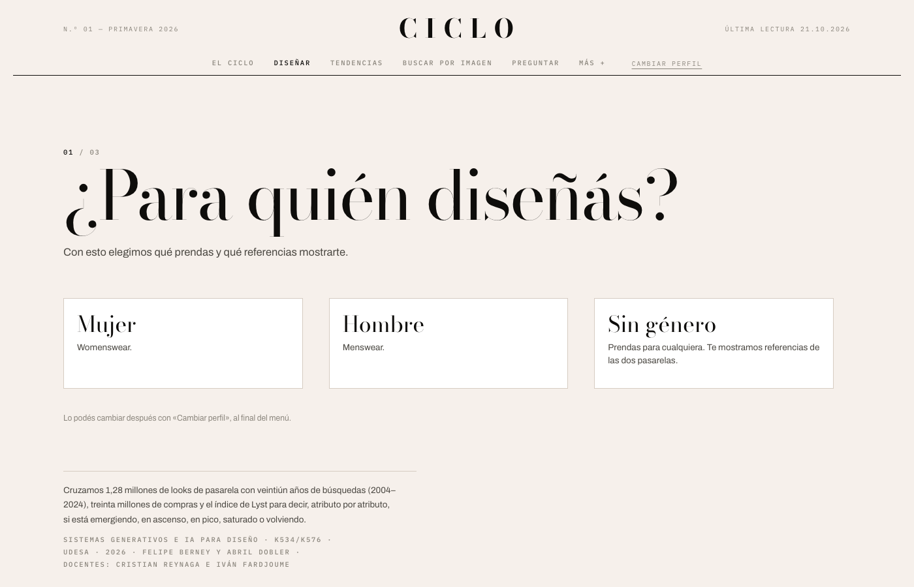
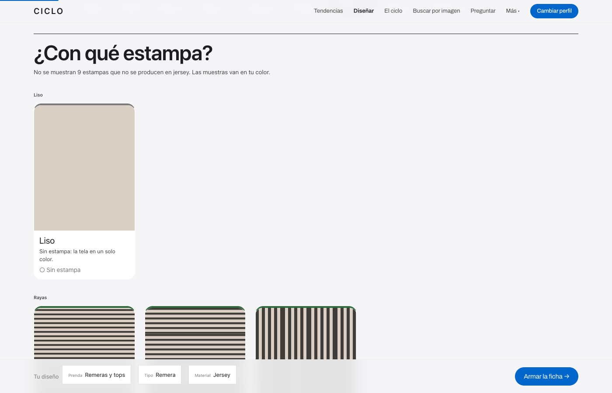
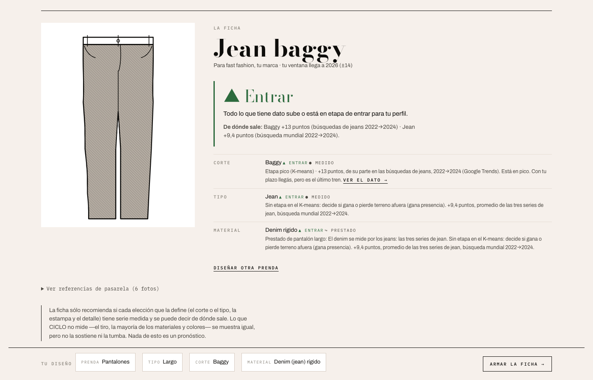
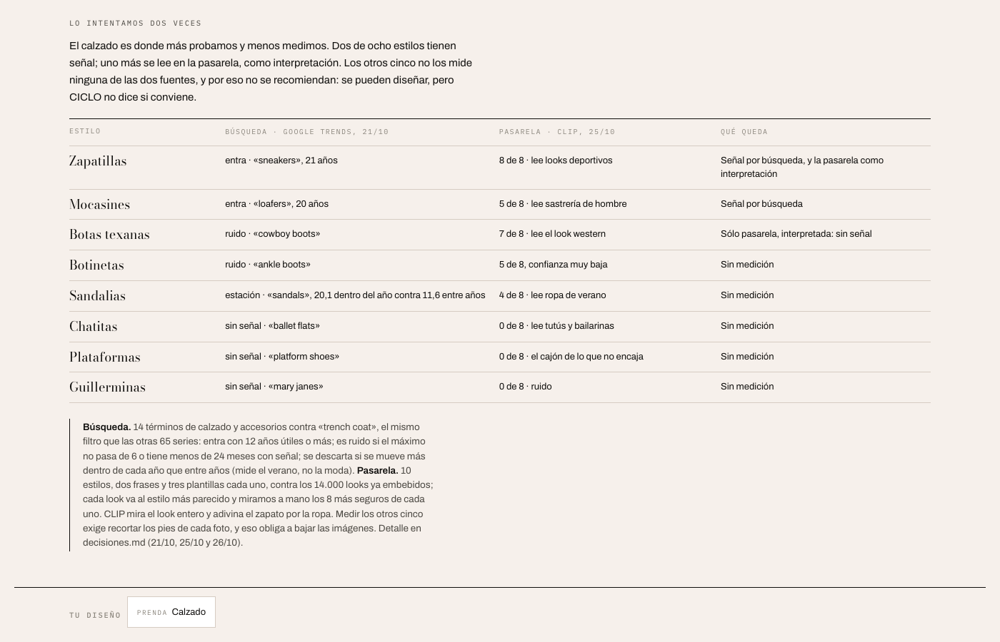
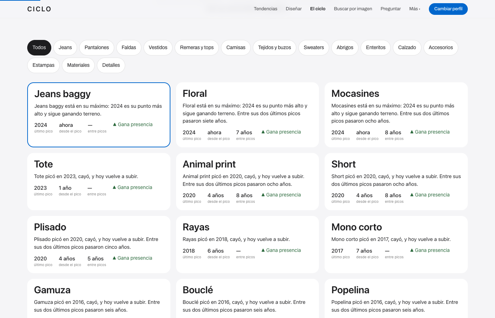
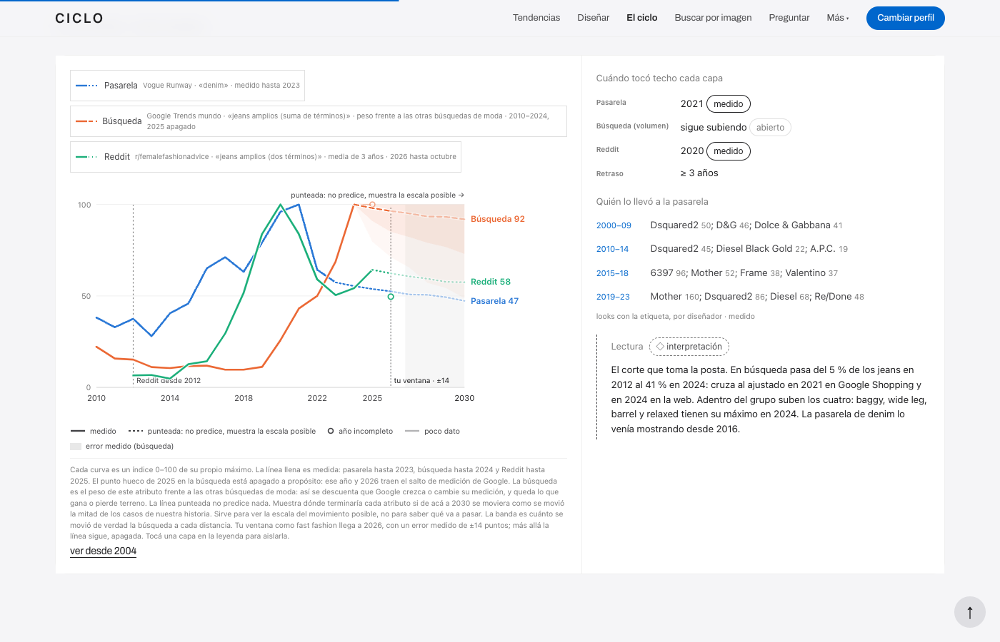

# CICLO

Web app que ubica atributos de moda —un color, una estampa, un corte, un material— en una de cinco
etapas de su ciclo de vida: **emergente, en ascenso, en pico, saturada o en retorno**.

Materia: *Sistemas generativos e IA para Diseño* (K534/K576) · Universidad de San Andrés · 2º semestre 2026
Docentes: Cristian Reynaga e Iván Fardjoume

## Integrantes

- Felipe Berney
- Abril Dobler

## Link al sitio

| | |
|---|---|
| App publicada (oficial) | https://felipeberney-boop.github.io/ciclo/ |
| Presentación Entrega 3 | https://felipeberney-boop.github.io/ciclo/presentacion/ |
| Espejo | https://ciclo-udesa.netlify.app — **pausado**: la cuenta gratuita de Netlify se quedó sin créditos en octubre de 2026 y no publica desde el commit `e2c4e4b`; muestra una versión anterior |
| Cómo se publica | GitHub Pages publica la carpeta `app/` en cada push que la toca (`.github/workflows/publicar_app.yml`). `netlify.toml` y `netlify/functions/` quedan en el repo pausados: la app no depende de ellos |

## Capturas

La app arranca con tres preguntas —para quién diseñás, si trabajás para una marca o por tu cuenta, y la
categoría— y con eso decide qué mostrarte. Después abre en **Tendencias**, la pantalla principal; la marca CICLO
lleva ahí desde cualquier vista, y «Cambiar perfil» vuelve a las preguntas.



**Diseñar**: elegís prenda, tipo, corte, material, color, estampa y detalle, y cada opción trae su señal —Entrar,
Esperar o Salir, en color y con la palabra— y de dónde sale: medido, interpretado o prestado de un pariente. Lo que
no tiene dato se ve igual, con su dibujo y su definición, y dice por qué no se recomienda.





El calzado es donde más probamos y menos medimos. La pantalla lo cuenta estilo por estilo:



**El ciclo**: cuándo picó cada atributo y cuánto tardó en volver, y el recorrido de cada uno hasta 2030 (la
punteada no es un pronóstico):





Las 16 capturas actuales —incluido el teléfono y el panel «Más»— están en `entregas/entrega_3/capturas/` y se regeneran con
`node codigo/capturar_pantallas_de_la_app.js`; las de la Entrega 2, en `entregas/entrega_2/capturas/`.

## Hipótesis

Cruzando lo que la pasarela propone con lo que la gente busca y lo que el mercado masivo vende, se
puede ubicar cada atributo de moda en una etapa de su ciclo de vida. Y se puede hacer **sin que nadie
etiquete las etapas a mano**: el modelo agrupa los atributos que se mueven parecido y recién después
nosotros leemos qué etapa es cada grupo.

La unidad de análisis es el **atributo**, no la prenda ni «la tendencia»: es lo único que se puede
contar en las cinco capas a la vez.

## Cómo correrlo

No tiene build ni dependencias. La carpeta `app/` es un único archivo HTML.

```bash
cd app
python3 -m http.server 8000
```

Publicada en GitHub Pages desde la carpeta `app/`, sin comando de build. Nada corre en un servidor: los dos
modelos de lenguaje (IA-5 e IA-8) llaman a Groq desde el navegador con la clave que pega cada uno. Netlify
(`netlify.toml`, `netlify/functions/`) quedó pausado desde el 25/10/2026 y la app no lo usa.

Lo único que carga de afuera son las tipografías: la del sistema, y de Google Fonts, Inter como reemplazo de SF Pro.
Sin conexión funciona igual, con las tipografías del sistema.

## Las pantallas

| | |
|---|---|
| Entrada | Tres preguntas, siempre: para quién diseñás, marca o por tu cuenta, y la categoría. Después, Tendencias. «Cambiar perfil» vuelve acá |
| Tendencias | La pantalla principal: qué gana y qué pierde terreno afuera, y doce atributos con su paleta y su etapa. La marca CICLO lleva acá |
| El ciclo | Cuándo picó cada uno de los 65 atributos con serie y cuánto tardó en volver; el recorrido de cada uno por pasarela, búsqueda y Reddit hasta 2030, y los jeans por corte |
| Diseñar | Paso a paso: prenda › tipo › corte › tiro › material › color › estampa › detalle, con la señal y la procedencia de cada opción, una barra con lo elegido y la ficha final |
| Buscar por imagen | Subir una prenda: CLIP en el navegador dice qué atributos ve y qué looks de pasarela se le parecen |
| Preguntar | Chat con un LLM que contesta con los datos de CICLO, tu perfil, tu diseño y lo que CLIP leyó de tu foto (pegás tu API key de Groq) |
| El modelo | K-means sobre 17 atributos, paso a paso, con validación externa |
| Marcas | Lyst Index, 34 trimestres |
| Retornos | Qué vuelve y cada cuánto, con la misma serie y la misma regla de El ciclo |
| Método | Fuentes, recortes y límites declarados |

## Fuentes de datos

Los datasets originales **no están en el repositorio**: superan el límite de GitHub o requieren cuenta
para descargarlos. En `datasets/fuentes_y_descargas.md` está el link de descarga, la fecha en que lo
bajamos y la licencia de cada uno. En `datasets/diccionario.md`, qué significa cada columna.

| Capa | Fuente | Volumen usado | Período |
|---|---|---|---|
| Pasarela | Vogue Runway | 902.566 looks de colección | 2000–2023 |
| Búsqueda | Google Trends | 65 series mundiales + 14 términos en Argentina | 2004–2024 |
| Compra | Google Shopping | 25 términos | 2008–2025 |
| Redes | Reddit vía Arctic Shift | 4.404 posts de r/femalefashionadvice | 2012–2025 |
| Marcas | Lyst Index | 34 trimestres, 55 marcas | Q1-18 a Q2-26 |
| Alfombra roja | Launchmetrics | Met Gala 2025 | 2025 |
| Venta masiva | H&M Personalized Fashion Recommendations | 30.570.975 compras de adulto | 2018–2020 |
| Reseñas | Amazon Reviews | 1,1 M de reseñas | 2012–2023 |
| Catálogo | Zara feb-2024 + Wish 2020 | 1.593 productos | 2020–2024 |

Las series ya procesadas que usa la app están en `datasets_procesados/`.

## Dónde interviene la IA

Ocho puntos. Tres corren una sola vez, en batch; el resto se dispara con el usuario.

| | Momento | Técnica | Cuándo |
|---|---|---|---|
| IA-1 | Etiquetado de pasarela | Modelo de visión | batch |
| IA-2 | Enlace de registros entre las 8 fuentes | Comparación de pares + clasificación | batch |
| IA-3 | Agrupar atributos | K-means no supervisado, k=4 | al cargar |
| IA-4 | Ubicar una tendencia nueva | Asignación al centroide más cercano | en vivo |
| IA-5 | Leer y recomendar | LLM (Groq) con prompt RACE, desde el navegador con tu API key | en vivo |
| IA-6 | Consulta por imagen | CLIP en el navegador: zero-shot + looks parecidos | en vivo |
| IA-7 | Diseñar: referencias y colores | CLIP sobre la pasarela de Vogue | batch |
| IA-8 | Preguntale a CICLO | LLM (Groq) desde el navegador, con tu API key y `llm/ciclo_datos.md` | en vivo |

**La regla que atraviesa todo:** el modelo de lenguaje nunca ve una fila de la base. Recibe métricas ya
calculadas —nivel, momento, crecimiento, distancia al pico— y el tipo de cliente. Todo lo que devuelve
aparece en la interfaz marcado como interpretación. Los prompts están versionados en `prompts/`.

**Claves de API:** no hay ninguna en el repositorio. IA-5 (Recorridos → «Pedir lectura en vivo») e IA-8
(«Preguntar») funcionan como la V2 de la clase: cada uno pega su API key de Groq en la página, queda guardada
sólo en su navegador y es la misma para los dos. El `.gitignore` bloquea `.env` y similares.

## El modelo

K-means sobre 17 atributos que existen a la vez en la pasarela y en Google Trends, con cuatro variables
estandarizadas: nivel y momento en pasarela, nivel y momento en búsqueda. La búsqueda llega hasta 2024:
nivel 2023–24 contra su máximo, momento 2023–24 contra 2020–21 (`codigo/recalcular_kmeans_sin_2025.py`).

`k = 4`. La silhouette no elige cuatro (k=2 0,361 · k=3 0,287 · k=4 0,320 · k=5 0,348): los datos no piden
cuatro, pero con menos no se separan etapas. Con 4, Y2K queda solo en su grupo. Los grupos se nombran por la
combinación de etapas teóricas más cercana a los cuatro centros a la vez.

Los grupos que encontró, leídos como etapas (jeans ya reagrupados: mom y boyfriend cuentan en los medios):

- **En ascenso** — Y2K
- **En pico** — Jeans amplios · Cargo
- **Saturada** — Jeans medios · Jeans ajustados · Buzo/hoodie · Floral · Kimono · Capa · Trench · Blazer oversize
- **En retorno** — Lunares · Cuero · Animal print · Encaje · Cuadros · Piel

Hasta el 20/10/2026 el modelo usaba la búsqueda 2024–25. Sacar ese año y después reagrupar los jeans (mom y
boyfriend a los medios) movió varios atributos de grupo; los pasos intermedios están en `decisiones.md`. La
asignación de arriba es la vigente y se reproduce exacta con `codigo/recalcular_kmeans_sin_2025.py`.

Validado contra dos capas que el modelo no usó: reseñas de Amazon (2019→2022) y Google Shopping
(2021-22→2024-25). Los jeans ajustados, en «saturada», caen 39 % en Amazon mientras los amplios suben 79 %.

## Decisiones de diseño

- **La etapa se codifica como posición en una pista, no como color.** Hay cinco etapas y el color ya
  está ocupado por la ropa, que es el dato que la usuaria vino a ver. La posición es además el canal
  perceptual más preciso (Munzner).
- **El color dice una sola cosa: si conviene avanzar o frenar.** Verde, ámbar y rojo son la señal —Entrar,
  Esperar (o Explorar, si trabajás por tu cuenta), Salir—, siempre con la palabra y un ícono; lo que no tiene dato
  es neutro. «▲ Gana presencia» y «▼ Pierde presencia» llevan el mismo verde y rojo, sólo en la palabra y la flecha.
  De dónde sale el dato se dice sin color: ● medido, ◇ interpretado (punteado), ↪ prestado. Los gráficos usan color
  sólo para separar sus series. Hay un único color más: **el azul, que significa «se puede tocar»** (botones de
  acción, links, la opción elegida).
- **Como una página de producto, pero de ropa.** Desde el 27/10 la app sigue el sistema visual de las páginas de
  producto de Apple (sin su marca): la tipografía del sistema (SF Pro en Mac e iPhone, Inter en el resto), títulos
  centrados en semibold, un lienzo gris perla con tarjetas blancas de 18 px, píldoras, ningún texto en mayúsculas
  espaciadas, sin sombras en la interfaz y un bloque oscuro para lo que gana y pierde terreno. La interfaz se corre
  para que hablen las prendas: sus dibujos y sus paletas. Siempre en claro. Antes fue una revista (Bodoni y crema,
  20/10); las versiones viejas están en `diseno/prototipos/versiones_de_la_app/`.
- **La entrada es por prenda y por corte.** Dentro de un mismo atributo hay ciclos opuestos: si se mira
  «denim» agregado, los amplios y los ajustados se cancelan y no se ve nada.
- **Ningún número aparece sin su fuente.** Cada ficha declara qué capa puede y qué capa no puede responder.

El registro completo de lo que se probó y se descartó está en `decisiones.md`. Qué parte de la hipótesis está verificada,
qué está refutada y qué falta probar, con cada prueba y su fuente, está en `hipotesis.md`.
La evolución del proyecto, versión por versión, está en `historial.md` — y cada versión tiene su commit
fechado en el historial de este repositorio.

## Licencias y atribución

Verificado el 13/10/2026 fuente por fuente. **Tres de las fuentes no declaran ninguna licencia** —
Vogue Runway, Amazon Reviews y Wish—, lo que no significa que sean libres sino que nadie otorgó
permiso explícito. Las usamos sólo para análisis académico, no redistribuimos ningún dataset y
citamos cada origen. El detalle está en `datasets/fuentes_y_descargas.md`.

La única cita formalmente exigida es la de Amazon Reviews:

> Hou, Y., Li, J., He, Z., Yan, A., Chen, X., & McAuley, J. (2024). *Bridging Language and Items for
> Retrieval and Recommendation.* arXiv:2403.03952.

Google Trends se usa bajo los términos de servicio de Google, con atribución y sin redistribuir.
H&M es de una competencia de Kaggle: uso académico y no comercial. El Lyst Index es contenido
editorial de Lyst, citado por trimestre y sin redistribuir el informe.

El Zara de febrero 2024 es «ZARA Sales» de Kaggle (`xontoloyo/data-penjualan-zara`), con licencia MIT.
No se había guardado el link: lo identificamos y verificamos contra la copia del Drive (mismo tamaño
exacto, filas, SKU y fecha). El detalle está en `datasets/fuentes_y_descargas.md`.

## Límites declarados

- **No detectamos lo emergente.** La pasarela pública llega hasta 2023.
- **El corpus mezcla menswear y womenswear.** Separarlo exige volver a agregar desde el archivo original.
- **El calzado se mide poco, y lo intentamos dos veces.** Google Trends (14 términos): entran «sneakers» y
  «loafers»; «sandals» mide el verano, y los demás son ruido o vuelven sin señal. CLIP sobre 14.000 looks de pasarela:
  acierta zapatillas (8 de 8) y botas texanas (7 de 8), pero lee la ropa, no el zapato; chatitas, plataformas y
  guillerminas, 0 de 8. Quedan cinco estilos que ninguna fuente mide; se muestran igual en Diseñar, con el motivo.
  Es donde Lyst ve las señales más fuertes de 2023 y 2024.
- **Google Trends tiene deriva:** el salto de medición empieza en 2025 (cambio medio +18,9 contra +3,2
  histórico; 12 de 16 series tocan su máximo ese año) y sigue en 2026. La búsqueda se mide hasta 2024; 2025
  se dibuja tenue y 2026 se excluye. El K-means usa la búsqueda hasta 2024.
- **Lyst recalibró su fórmula en Q1-26.** Es un corte en la serie, no un crecimiento real: las métricas
  se calculan dentro de cada tramo, nunca a través.
- **Zara 2018–22 y Mix de marcas son sintéticos.** Correlación casi nula entre variables. Sirven para
  mostrar el método, no para concluir.
- **Pinterest y TikTok** piden sesión iniciada. **Instagram** no tiene serie histórica de hashtags a
  ningún precio: es un resultado negativo documentado, no un olvido.

## Qué falta

Separar pasarela y venta por género (declarado como límite en Método). Leer el calzado recortando los pies de
cada foto, que es lo único que permitiría medir chatitas, plataformas o guillerminas en la pasarela.

## Estructura del repositorio

```
ciclo/
├── readme.md                  este archivo
├── decisiones.md              registro fechado de lo que probamos y descartamos
├── historial.md               las versiones del proyecto, de la hipótesis al prototipo
├── .gitignore
├── netlify.toml               pausado: el deploy vivo es GitHub Pages
├── netlify/functions/         pausado: lectura.mjs, la versión con servidor de IA-5
├── datasets/                  diccionario y links de descarga (los CSV no se suben)
├── datasets_procesados/       las series que consume la app
├── diseno/                    referencias y prototipos por versión
├── prompts/                   prompts del LLM, versionados
├── codigo/                    scripts de extracción, cálculo y render
├── entregas/                  estado del proyecto en cada entrega
└── app/                       lo que se publica (GitHub Pages)
```
